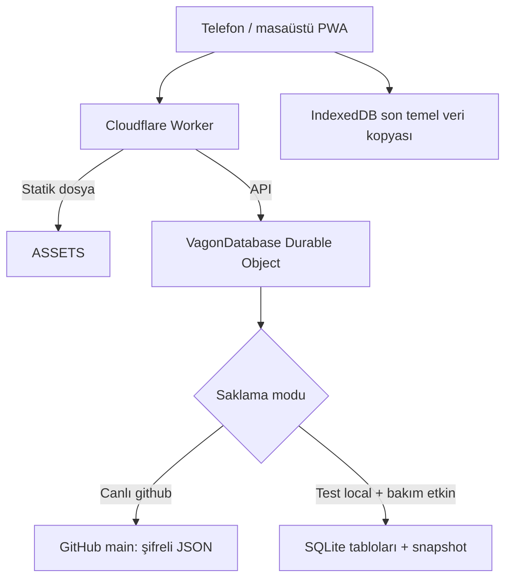

# Vagon Takip — başka bir AI aracına teknik ve işletim devir rehberi

Belge tarihi: **19 Ekim 2026, Türkiye saati**. Depo: **ilyasilmek/vagontakip**. Dil: Türkçe. Belge tipi: Markdown (`.md`).

Bu belge projeyi başka bir geliştiricinin veya AI aracının sohbet geçmişine ihtiyaç duymadan inceleyebilmesi, yerelde derleyebilmesi ve mevcut sistemi koruyarak geliştirebilmesi içindir. Kullanıcının istediği iş kuralları ile kodda gerçekten uygulanmış davranış ayrı açıklanır. Bu belge hazırlanırken uygulama kodu, çalışma verisi ve çalışan yayın değiştirilmedi.

**Başlangıç noktası `maintenance-test` dalıdır. Bakım geliştirmesi hâlâ test aşamasındadır. Kullanıcının açık onayı olmadan `main` dalına birleştirme veya canlı `vagontakip` Worker'ına yayın yapılmaz.** Test yayını izni canlı yayın izni değildir. Her anlamlı değişiklik aynı commit içinde [geliştirme raporuna](gelistirme-raporu.md) eklenir.

Bu rehberde gerçek parola, API tokenı, oturum çerezi, veri şifreleme anahtarı veya personel kayıt dökümü bulunmaz. Bunlar özel depoda bile düz metin olarak tutulmaz. Gerekli bütün bağların adları, kullanım amaçları, erişim yerleri ve güvenli aktarım şartları aşağıdadır. **Bir rapor, kayıp bir şifreleme anahtarının veya Cloudflare'daki test verisinin yerine geçmez.** Kodla çalışmak için canlı sırlar gerekmez; mevcut canlı veriyi taşıyabilmek için eşleşen anahtarın ayrıca güvenli kasadan sağlanması gerekir.

## İçindekiler

1. [Devir anındaki durum ve doğrulama sınırı](#1-devir-anındaki-durum-ve-doğrulama-sınırı)
2. [Araçlar ve ilk çalıştırma](#2-araçlar-ve-ilk-çalıştırma)
3. [GitHub ve Cloudflare'ın görevleri](#3-github-ve-cloudflareın-görevleri)
4. [Mimari ve dosya haritası](#4-mimari-ve-dosya-haritası)
5. [Veri modeli ve kaydetme prensibi](#5-veri-modeli-ve-kaydetme-prensibi)
6. [Ekranlar, alanlar ve tuşlar](#6-ekranlar-alanlar-ve-tuşlar)
7. [Vagon numarası ve vagon tipi](#7-vagon-numarası-ve-vagon-tipi)
8. [Saha iş girişi hesapları](#8-saha-iş-girişi-hesapları)
9. [Personel, vardiya, kapasite ve sürüm 2 hesapları](#9-personel-vardiya-kapasite-ve-sürüm-2-hesapları)
10. [Eski hesap sürümü ve raporlar](#10-eski-hesap-sürümü-ve-raporlar)
11. [API sözleşmeleri](#11-api-sözleşmeleri)
12. [Parolalar, secret bağları ve erişim envanteri](#12-parolalar-secret-bağları-ve-erişim-envanteri)
13. [Derleme, test, yayın ve CI](#13-derleme-test-yayın-ve-ci)
14. [Veri yedekleme, geri dönüş ve proje devri](#14-veri-yedekleme-geri-dönüş-ve-proje-devri)
15. [Bilinen sınırlar ve sonraki AI'ın incelemesi gereken noktalar](#15-bilinen-sınırlar-ve-sonraki-aiın-incelemesi-gereken-noktalar)
16. [Hata çözümleme](#16-hata-çözümleme)
17. [Yeni AI için başlangıç talimatı](#17-yeni-ai-için-başlangıç-talimatı)
18. [Ek A — güncel Fren işlerinin tamamı](#ek-a--güncel-fren-işlerinin-tamamı)
19. [Ek B — tarihsel 49 iş standardı](#ek-b--tarihsel-49-iş-standardı)
20. [Ek C — dosya envanteri](#ek-c--dosya-envanteri)
21. [Ek D — Git değişiklik günlüğü](#ek-d--git-değişiklik-günlüğü)

## 1. Devir anındaki durum ve doğrulama sınırı

| Başlık | Canlı uygulama | Bakım test uygulaması |
| --- | --- | --- |
| Adres | https://vagontakip.ilyasilmek.workers.dev | https://vagontakip-test.ilyasilmek.workers.dev |
| Worker adı | `vagontakip` | `vagontakip-test` |
| Kod dalı | `main` | `maintenance-test` |
| Yapılandırma | `wrangler.jsonc` | `wrangler.test.jsonc` |
| Kalıcı iş verisi | GitHub `main:data/database.enc.json` | Ayrı Cloudflare SQLite Durable Object |
| `STORAGE_MODE` | `github` | `local` — burada “local”, Worker içindeki kalıcı alanı ifade eder |
| `MAINTENANCE_ENABLED` | Etkin değil | `true` |
| Son bilinen uygulama özellik commit'i | `6096db4` | `0e5fe93` |
| Son bilinen test Worker sürümü | Bu belgede yeniden sorgulanmadı | `89c0a6e7-2d79-40bf-b144-c31741edd2e7` |

19 Ekim'de `origin/main` salt okunur fetch ile kontrol edildi: son commit `6ca361d`, veritabanı güncellemesi `v23`; son kod özelliği `6096db4`. Kod commit'i ve veri commit'i farklı kavramlardır. Bu rehber öncesi test dalı belge commit'i `873c334` idi. Yayın bilgisi 18 Ekim'deki [geliştirme raporuna](gelistirme-raporu.md) dayanır; yeni bir uygulama yayını yapılmış sayılmaz.

18 Ekim'de son özellik için 87 birim/API testi, test derlemesi ve Hava&Fren katalog görünürlüğünü sınayan 1 yerel Chromium testi geçti. Uzak test kataloğunda 55 etkin iş ve 11 kategori doğrulandı. **Bütün Playwright paketinin bugün eksiksiz geçtiği iddia edilmez.** Eski ekran akışlarına bağlı testler vardır; bölüm 15'i okuyun.

19 Ekim'de bu dokümantasyon için kaynaklar, Git durumu ve yalnız Worker secret **adları** incelendi. Canlı Worker'da `ADMIN_PASSWORD`, `DB_ENCRYPTION_KEY`, `GITHUB_TOKEN`, `SESSION_SECRET`; test Worker'da `ADMIN_PASSWORD`, `SESSION_SECRET` adlarının bulunduğu doğrulandı. Değerleri okunmadı. Bu adların bulunması her değerin doğruluğunun ayrıca sınandığı anlamına gelmez.

Belge önceliği: çalışılan commit'in kodu ve testleri → bu güncel devir rehberi → geliştirme raporunun ilgili tarihli kaydı → ilk kurulum belgeleri. Eski belgelerdeki “depo public”, “erişim bağları eksik”, “52 iş”, “11 veya 12 rakam” ve “G/P'den biri seçilir” gibi ifadeler tarihsel olabilir. Güncel durum aşağıda açıklanır.


20 Ekim 2026 notu: kısa süreli DBKK test Worker denemesinden sonra kullanıcı eski test ortamına dönülmesini istedi. `wrangler.test.jsonc`, `scripts/deploy-test.mjs` ve GitHub Actions sağlık kontrolü tekrar `vagontakip-test` hedefine ayarlandı. Bu mevcut test alanının SQLite verisini korumak için önemlidir. `dbkk-vagontakip-test` ayrı ve geçici bir Worker'dır; eski test verisi oraya taşınmamıştır. DBKK Worker'ı Cloudflare hesabından ayrıca silmek için eski test dağıtımı ve sağlık kontrolü doğrulanmalıdır. Canlı Worker adı/adresi değişmez.


20 Ekim 2026 güncel durum notu: kullanıcı geçici DBKK test Worker'ından vazgeçip eski `vagontakip-test` adresine dönülmesini istedi. Güncel test yapılandırması ve deploy yardımcısı yalnız `vagontakip-test` hedeflemelidir. GitHub Actions önce eski test Worker'ını yayımlar ve sağlık kontrolünü doğrular; ardından geçici `vagontakip-test` Worker script'ini silmeyi dener. Son Actions sonucu görülmeden silmenin tamamlandığını varsaymayın. Canlı `vagontakip` Worker'ı değiştirilmeyecek.

## 2. Araçlar ve ilk çalıştırma

### 2.1 Gerekli ve isteğe bağlı araçlar

| Araç / hizmet | Kullanım | Gereklilik |
| --- | --- | --- |
| Git | Private depoyu çekmek, dal ve commit yönetmek | Yerel çalışma için gerekli |
| GitHub hesabı / depo erişimi | Private kaynak kodunu okumak; yetkiliyse push | Gerekli |
| Node.js | TypeScript, Vite, test ve Wrangler | `package.json` en az `22.12.0`; pratik öneri ve CI sürümü **24** |
| npm | Kilitli bağımlılık kurulumu | Gerekli; bu ortamda 11.9.0 görüldü |
| Python 3 | Eski Windows SQLite aktarımı, belge/yardımcı işlemler | Normal uygulama derlemesi için gerekli değil |
| Chromium / Playwright | Telefon boyutunda iş akışı ve PWA testi | Tarayıcı doğrulaması için gerekli |
| Cloudflare hesabı | Mevcut yayın ve Durable Object yönetimi | Uzak yayını yönetmek için gerekli |
| Wrangler | Worker derleme/yayın/secret komutları | npm ile yerel kurulur; global kurulum gerekmez |
| Bir AI aracı | Kod inceleme/değişiklik yardımı | Uygulamanın çalışma zamanı bağımlılığı değil |
| VS Code / benzeri editör | Dosya düzenleme | İsteğe bağlı |

19 Ekim'de çalışma ortamında Node `v24.19.0`, npm `11.9.0`, Python `3.12.14` görüldü. SQL testleri `node:sqlite` kullanır: Node 22.13+ veya Node 24 tercih edin; 22.12 kullanılıyorsa `NODE_OPTIONS=--experimental-sqlite` gerekebilir. `package-lock.json` kesin paket çözümünü tutar; `npm ci` kullanın, sırf kurulum için lock dosyasını yeniden üretmeyin.

### 2.2 Yeni makinede kodu alma

```bash
git clone --branch maintenance-test https://github.com/ilyasilmek/vagontakip.git
cd vagontakip
git status -sb
node --version
npm --version
npm ci
npm run setup:local
npm run typecheck
npm test
npm run build:test
```

Private repo erişimi GitHub oturumu, SSH anahtarı veya aracın desteklediği HTTPS Git kimliğiyle sağlanır. Tokenı remote URL'sine yazmayın. Mevcut çalışma alanı varsa önce `git status -sb` kontrol edin; kullanıcının değişikliklerini silmeyin, veritabanına reset uygulamayın. Bu repoda mevcut checkout kullanılır; ayrıca worktree istenmedikçe oluşturulmaz.

### 2.3 Yerel bakım pilotunu açma

```bash
npm run dev:maintenance
```

Yerel derlenmiş uygulama: `http://127.0.0.1:8788`. Bu adres yalnız geliştiricinin kendi makinesinde kullanılır. Gerçek telefon testi için telefonun erişebildiği güvenli bir test yayını gerekir.

`npm run setup:local`, `.dev.vars` yoksa rastgele yerel bağlar ve `.local/test-credentials.json` oluşturur. Kullanıcı adı/şifreyi bu **özel yerel dosyadan**, güvenli terminal veya editörle alın. Üretim şifresi gerekmez. Mevcut `.dev.vars` varsa script dosyayı koruyup çıkar; eksik yerel giriş dosyasını kendiliğinden onarmayabilir. Yerel hesabın adı `.dev.vars` içindeki `ADMIN_USERNAME` değeridir; uzaktaki test Worker varsayılan adı `testadmin` ile karıştırmayın.

Yerel durum `.local/maintenance-worker-state` altında kalır. Bu klasörü silmek yerel test verisini kaybettirir. Uzak test verisini silmez; iki alan ayrıdır.

### 2.4 Temel uygulama ve hızlı arayüz geliştirmesi

```bash
npm run build
npm run dev:api
```

Temel yerel Worker `http://127.0.0.1:8787` üzerindedir. İkinci terminalde `npm run dev`, Vite arayüzünü 5173 portunda açar. `vite.config.ts` içindeki `/api` proxy hedefi sabit **8787**'dir. Bakım pilotu 8788'de çalışırken 5173'ün kendiliğinden ona bağlandığını varsaymayın; pilot için 8788'de derlenmiş uygulamayı kullanın veya bilinçli yerel proxy düzenlemesi yapın. `npm run preview` yalnız statik önizlemedir, Worker API'sini başlatmaz.

Bash ortamındaki `VITE_TEST_ENVIRONMENT=true` gibi komutlar Windows PowerShell'de aynı biçimde çalışmaz. Windows'ta WSL/Bash kullanmak mevcut npm komutlarıyla en az sürprizli yoldur. `build:test` ve CI komutları için bu farkı dikkate alın.

### 2.5 Başka bir AI bulut ortamı için hazır kurulum tarifi

Çalışma dizini farklıysa yalnız `VAGON_REPO_DIR` ayarlanır. Bu taslak secret içermez; yerel/test hazırlığı yapar, deploy etmez:

```bash
#!/usr/bin/env bash
set -euo pipefail
cd "${VAGON_REPO_DIR:-/workspace/vagontakip}"
node -e 'if (Number(process.versions.node.split(".")[0]) < 24) throw new Error("Bu devir tarifi Node 24 veya üstü ister")'
npm ci
npm run setup:local
npm run build:test
```

Başlatma yönergesi: mevcut checkout ve `maintenance-test` dalını kontrol et, kullanıcının değişikliklerini koru, yukarıdaki kurulumdan sonra `npm run dev:maintenance` çalıştır, 8788 `/api/health` ve `/api/session` yanıtlarını kontrol et. Arka planda çalışan süreç her yeni makinede yeniden başlatılmalıdır; dosyanın disk üzerinde kalması sunucunun çalıştığı anlamına gelmez. Kod geliştirmek için Cloudflare/GitHub çalışma zamanı sırları istenmez. Sadece yetkili uzak yayın gerektiğinde bölüm 12'deki geliştirme bağları eklenir. Yeni aracın gizli anahtar/dizin paylaşımı ve internet izinleri bu talimatlardan ayrı kendi ayarlarında yapılır.

## 3. GitHub ve Cloudflare'ın görevleri

### 3.1 GitHub'ın dört ayrı rolü

1. **Kaynak kod:** React arayüzü, Worker, ortak hesaplama modülleri, testler ve belgeler burada sürümlenir.
2. **Canlı veri:** `main` dalındaki `data/database.enc.json`, canlı kayıtlar, kullanıcı parola özetleri ve audit olaylarının AES-256-GCM ile şifrelenmiş kalıcı dosyasıdır.
3. **Değişiklik ve belge geçmişi:** Her kod değişikliği commit olur. Canlı veriye başarılı yazma da ayrıca otomatik veri commit'i üretir. Testte girilen kayıtlar ise buraya otomatik veri commit'i olarak gitmez.
4. **CI ve olası Cloudflare Git bağlantısı:** GitHub Actions test/derleme çalıştırır. Cloudflare Workers Builds bağlantısı ayrıca kurulmuşsa seçilen dalı yayımlayabilir; bunun panel ayarı repodaki Actions işlerinden ayrıdır.

Kodun GitHub'a push edilmiş olması, bakım test verisinin yedeklendiği veya test Worker'ın güncellendiği anlamına gelmez. Bu projedeki Actions dosyaları kontrol yapar; içlerinde uzak Worker deploy adımı yoktur. Test yayını ayrıca `npm run deploy:test` ile yapılır.

Depo private yapılmıştır. Uygulama bundan sonra kullanıcı tarafından kayıt ekleme/silme ile denenmiş ve çalıştığı bildirilmiştir. Private depo erişimi için Worker'ın `GITHUB_TOKEN` yetkisi ve Cloudflare Git uygulamasının erişimi sürmelidir.

### 3.2 Cloudflare'ın rolü

- Aynı HTTPS adreste statik PWA dosyalarını ve `/api/*` API'sini sunar.
- Worker giriş doğrulaması, yetki kontrolü, şifreleme ve kayıt işlemlerini yürütür.
- `DB` binding'i `VagonDatabase` Durable Object sınıfına bağlıdır.
- Tüm API çağrıları Worker başına `idFromName('vagontakip-canonical-v1')` ile aynı mantıksal nesneye yönlenir.
- Nesnenin açık bir Promise kuyruğu vardır; ağ beklenirken bile bütün okuma/yetki/CAS/yazma akışını sırayla işler.
- Test Worker'ının nesne alanı canlı Worker'dan ayrıdır. Aynı sınıf adı aynı veri alanı demek değildir.
- Testte SQLite tabloları asıl veridir; canlıda Durable Object kopyası GitHub dosyasının önbelleğidir.
- Bu projede ayrı Cloudflare Pages sitesi, D1 veritabanı, R2 bucket veya kiralık VPS gerekmiyor. Panelde “Workers & Pages” yazması Pages kullanıldığı anlamına gelmez.

### 3.3 İstek akışı



## 4. Mimari ve dosya haritası

### 4.1 Teknoloji ve uygulama katmanları

Arayüz React 19 + TypeScript, Vite 7 ile derlenir. ExcelJS Excel oluşturur; Lucide React ikon sağlar; IBM Plex Sans ve Condensed yazı tipleri npm paketlerinden gelir. Sunucu TypeScript Cloudflare Worker'dır. Zod istek/veri şemalarını doğrular. WebCrypto parola özeti, veri şifreleme ve oturum imzasını yapar. Vitest birim/API testlerini, Playwright yerel Chromium iş akışlarını çalıştırır.

`client/` kullanıcı etkileşimi; `server/` yetki, doğrulama ve kalıcılık; `shared/` veri tipleri, iş katalogları, hesap fonksiyonları; `scripts/` kurulum/derleme/yayın yardımcılarıdır. Derleme çıktısı `dist/client` ve üretilen `sw.js` Git takibinde değildir.

### 4.2 Arayüz kaynakları

| Dosya (`client/src/`) | Görev |
| --- | --- |
| `main.tsx` | React başlangıcı, tema başlangıcı, service worker kaydı/güncelleme |
| `App.tsx` | Oturum, veri çekme, çevrimiçi durum, gezinme, temel kayıt ve bakım pencerelerinin koordinasyonu |
| `Login.tsx` | Giriş formu ve GBZ marka alanı |
| `Dashboard.tsx` | Genel bakış metrikleri, ilk 5 vagon, Excel ve Planlama geçişi |
| `Collection.tsx` | Vagon/parça/demirbaş listesi, arama, filtre, CSV ve sıralama |
| `RecordEditor.tsx` | Temel kayıt ekleme, ayrıntı, düzenleme, silme ve yinelenen numara sorusu |
| `WagonNumberInput.tsx` | Rakam ayıklama, biçimlendirme, imleç ve alan hata yönetimi |
| `WagonMaintenanceHistory.tsx` | Vagonun saha işleri ve planlama geçmişi; ilgili bakım formunu düzenleme için açma |
| `SimpleWorkEntry.tsx` | Kullanıcı ve yöneticinin ortak sade iş girişi; ekip, ek iş, ağır bakım, G/P |
| `Workshop.tsx` | Test Bakım ekranı, yönetici Planlama, raporlar, vardiya/standart ayarları |
| `WorkshopForms.tsx` | Personel, günlük atölye, faaliyet, personel seçim bileşenleri, checklist ve detaylı planlama formu |
| `Maintenance.tsx` | İlk pilotun eski toplu ekip/bekleme formu; yeni Planlama ile aynı model değil |
| `Reports.ts` | Üç sayfalı genel Excel |
| `Account.tsx`, `Admin.tsx` | Hesap tercihleri/şifre/posta; kullanıcı ve audit yönetimi |
| `api.ts` | `/api` fetch yardımcısı ve IndexedDB temel kayıt kopyası |
| `navigation.ts`, `Modal.tsx` | History API geri tuşu, modal yığını, odak, Escape ve kapatma |
| `records.ts`, `sorting.ts`, `SortSelect.tsx` | Alan tanımları, CSV, tarih gösterimi ve sıralama |
| `theme.ts`, `startupPreference.ts`, `Startup.tsx` | Cihaz teması, animasyon tercihi, açılış animasyonu |
| `Install.tsx` | Android/iOS kurulum yönergeleri ve uygun tarayıcıda kurulum istemi |
| `styles.css` | Tüm temalar, responsive yerleşim, düğmeler, yazdırma ve arka plan |

### 4.3 Sunucu ve ortak kaynaklar

| Dosya | Görev |
| --- | --- |
| `server/index.ts` | Worker export, Durable Object, oturum, Origin, giriş sınırı, temel CRUD ve admin uçları |
| `server/database.ts` | Snapshot, bootstrap, GitHub/local ayrımı, veri doğrulama ve mutasyon/commit döngüsü |
| `server/github.ts` | GitHub Contents/Blob API, dosya SHA ile koşullu yazma ve hata dönüşümü |
| `server/crypto.ts` | PBKDF2, AES-GCM, HMAC oturum imzası |
| `server/models.ts` | Temel kayıt/kullanıcı/veritabanı şemaları, güvenli kullanıcı çıktısı ve vagon tarih kuralları |
| `server/workshop-routes.ts` | Pilot API'leri; katalog/ekip, saha iş girişi, planlama, günlük atölye, faaliyet ve ayarlar |
| `server/workshop.ts` | Sürüm 2 giriş şemaları, kişi-zaman kısıtları ve standart satırı çözümü |
| `server/workshop-storage.ts` | SQLite şeması, ilişkiler, snapshot'tan yükleme ve atomik yazma |
| `server/maintenance.ts` | İlk pilotun kayıt şeması ve doğrulaması |
| `server/errors.ts` | Tutarlı JSON hata yanıtları |
| `shared/types.ts` | Vagon/parça/demirbaş, roller, posta adları ve temel API yanıt tipleri |
| `shared/wagon-types.ts` | Vagonun ikinci numara bloğundan otomatik tip eşleştirme |
| `shared/maintenance.ts` | Tarihsel 49 iş; eski sürüm 1 hesabı |
| `shared/workshop.ts` | Vardiyalar, aralık matematiği, ledger, kapasite ve sürüm 2 KPI |
| `shared/work-entry.ts` | Saha işinin standart/ek/ağır bakım dakika ve ekip hesabı |
| `shared/fren-postasi.ts` | Güncel Hava&Fren işleri, sabit kimlikler, adet bilgisi ve 18 Ekim standart sürümü |

Ek C tüm izlenen dosyaları listeler. Kullanıcı/personel çalışma kayıtları kaynak dosya envanterine dahil edilmez.

## 5. Veri modeli ve kaydetme prensibi

### 5.1 Temel kayıtlar

| Model | İş alanları |
| --- | --- |
| `Wagon` | `number`, türetilmiş `wagonType`, `entryDate`, `channelDate`, `completedDate`, `status`, `notes` |
| `Part` | `type`, `brand`, `quantity`, `serialNumber`, `wagonNumber`, `removedDate`, `sentDate`, `returnedDate`, `faultNotes` |
| `Inventory` | `type`, `brand`, `quantity`, `serialNumber` |
| `RecordMetadata` | `id`, `revision`, `createdAt`, `updatedAt`, `updatedBy` |
| `SafeUser` | `id`, `username`, `displayName`, `post`, `role`, `active`, oluşturma/güncelleme zamanı |
| `StoredUser` | SafeUser + `password` özeti ve `authVersion`; tarayıcıya verilmez |
| `AuditEvent` | Kimlik, zaman, aktör kimliği/adı, işlem, varlık türü/kimliği, isteğe bağlı açıklama |

`DatabaseDocument`: `formatVersion:1`, global `version`, `updatedAt`, `wagons`, `parts`, `inventory`, `users`, `audit`; pilotta ayrıca `jobTypes`, `maintenanceOperations`, `workshop`, `workEntries` bulunabilir. `formatVersion:1`, bakım formülünün sürümü 1 demek değildir; JSON belge formatı ayrı kavramdır.

Tarih alanları temel kayıtlarda `YYYY-MM-DD` veya boş dizge; bakım saatleri ISO 8601 olarak saklanır. Tarih/saat kullanıcıya Türkiye saatinde (`Europe/Istanbul`, UTC+3) gösterilir. Sayıların ekran yuvarlaması, saklanan hesap hassasiyetini değiştirmez.

### 5.2 Bir temel kayıt kaydedildiğinde

1. İstemci formu ve tarih sırasını kontrol eder, uygun POST/PATCH çağrısını yapar.
2. Worker aynı Origin, oturum ve aktif kullanıcı kontrolünü yapar; istemciden aktör yetkisi alınmaz.
3. Durable Object isteği sıraya alır.
4. `DatabaseEngine.mutate()` güncel veriyi yükler, `structuredClone` üzerinde işlem uygular.
5. PATCH/DELETE için `revision` karşılaştırılır; kullanıcı yönetiminde `updatedAt` karşılaştırması kullanılır.
6. Sunucu aktör/zaman/kimlikleri atar; bütün veritabanını ve pilot kişi-zaman ilişkilerini doğrular.
7. Global veri sürümü artar. Canlıda şifreli dosya GitHub'a SHA şartıyla yazılır; testte SQLite transaction tamamlanır.
8. Başarı yanıtından sonra istemci veriyi yeniler ve mesaj gösterir. Başarısız yazma kaydedilmiş sayılmaz.

Canlıda GitHub dosyası dışarıdan değişmişse 409/422 dosya çatışması kabul edilir; veri yeniden okunarak mutasyon en fazla 3 denemede uygulanır. Satır revision'ı eskidiyse kullanıcıya 409 döner. Ağ isteği zaman aşımı 15 saniyedir. Soğuk başlangıçta GitHub asıl dosyası yeniden okunur; eski Durable Object cache'i boş verinin üstüne yazılmaz. Sıcak okumada GitHub yenileme eşiği 10 saniyedir; mutasyon zorunlu güncel okuma ister.

Aktif audit listesi son 5.000 olayla sınırlıdır. Canlı dosyanın eski şifreli commit'leri ayrıca tarihsel kopyaları tutar. Testte otomatik GitHub veri commit geçmişi yoktur.

### 5.3 Yeni vagonla bakımın tek işlemde kaydı

Yeni vagon formundaki “Bakım ekle” henüz vagonu yazmaz. Vagon alanları bakım formuna taslak olarak geçer. Son Kaydet, `/api/workshop/work-entries/with-wagon` ile `{wagon, entry}` gönderir. İkisi aynı mutasyon/SQL transaction içinde oluşturulur. Bakım doğrulanmazsa vagon da oluşmaz. Bakımdan vazgeçmek önceki taslağa döner. Temel formdaki yalnız Kaydet, sadece vagon oluşturur.

### 5.4 Aynı numarayla ikinci vagon ziyareti

Numara benzersiz veritabanı anahtarı değildir; **`id` benzersizdir**. Yeni formda mevcut numara varsa mevcut kayda geçme veya yeni kayıt oluşturma sorusu çıkar. Hayır seçimi yeni `id` oluşturulmasına izin verir. En güncel oluşturulmuş eşleşme mevcut kayıt olarak önerilir.

Yeni saha iş girişleri `wagonId` ile ilgili ziyarete bağlanır. Geçmişte yalnız `wagonNumber` bulunan işler aynı numaradaki ilk vagon kaydında gösterilir. Planlama operasyonları da yeni kayıtlarda kimlik alır. Planlama formu yalnız numara aldığı için sunucu aynı numaradaki **son eklenmiş** vagona bağlar; bu ayrım bölüm 15'te açıklanır. Geçmişi tümden yalnız numara üzerinde birleştirmek iki ziyareti karıştırır.

### 5.5 SQLite tablosu ve ilişki envanteri

| Tablo | İçerik / ilişki |
| --- | --- |
| `workshop_snapshot` | Workshop tabloları dışındaki çekirdek veri ve snapshot başlığı; `workEntries` burada JSON içinde |
| `workshop_people` | Personel JSON satırları |
| `workshop_shifts` | Vardiya tanımları |
| `workshop_standards` | `versionId` anahtar, `job_id`, standart JSON |
| `workshop_days` | Günlük vardiya; `(date,shift_id)` benzersiz, shift FK |
| `workshop_attendance` | Gün/kişi anahtarı; gün ve personel FK |
| `workshop_orders` | Planlama operasyon başlıkları |
| `workshop_lines` | Operasyon/iş anahtarı; standart sürümü ve operasyon FK |
| `workshop_participation` | Operasyon, günlük vardiya ve katılım aralığı |
| `workshop_participation_people` | Katılıma bağlı gerçek kişiler |
| `workshop_waits` | Operasyona bağlı bekleme aralığı |
| `workshop_wait_people` | Bekleyen gerçek kişiler |
| `workshop_activities` | Günlük vardiya/isteğe bağlı operasyon, faaliyet türü ve aralık |
| `workshop_activity_people` | Faaliyete katılan kişiler |

Her kayıt, başlık ve ayrıntı değerlerinin bir kısmını JSON sütunlarında tutar; bu tamamen normalize edilmiş bir ERP şeması değildir. Gün/kişi/standart ilişkilerinde gerçek FK ve indeksler vardır. Yazıcı tüm workshop tablolarını bağımlılık sırasına göre transaction içinde yeniden yazar ve snapshot'ı upsert eder. Yük arttığında bütün tabloları yeniden yazma yaklaşımı ölçekleme konusu olur.

Eski KV snapshot'ından SQL'e geçiş eklemelidir; eski snapshot silinmez. Eski toplu ekip kayıtlarından kişi kimliği ve bekleme saati uydurulmaz. `loginLimits` ve `revokedSessions` Durable Object KV alanında ayrı tutulur; yalnız iş tablolarını kopyalamak bunları taşımaz.

## 6. Ekranlar, alanlar ve tuşlar

### 6.1 Roller ve ortak davranış

`user` ve `admin` rolleri vardır. Her iki rol temel kayıtları ekler/düzenler; temel kayıt silme ve kullanıcı yönetimi admin içindir. Hesap kendi kendine açılamaz. Yeni kullanıcıyı admin oluşturur. Son aktif admin silinemez, pasifleştirilemez veya normal kullanıcıya çevrilemez.

Hesabın `post` bilgisi iş kataloğunu ve birlikte çalışılan kişi listesini belirler. Seçilen ekipteki kişinin postası kataloğu değiştirmez. Güncel postalar: **Hava&Fren, Boji, Kaynak, Vagonaj, Meydan, Torna, Tren Teşkil, Büro**. Eski saklanmış `Fren` ve `Hava-Fren`, çıktı verirken `Hava&Fren` olarak normalize edilir; yeni seçim adları arasında değildir.

Temel kayıtlar herkesle ortaktır. Personel ve detaylı vardiya verisi normal kullanıcıya tam atölye API'sinden verilmez. Vagon bakım özetinde işi yapan adları admin görür; kullanıcı kendi iş girişini düzenleyebilir. Kullanıcının düzenleme hakkı sunucuda `actorId` ile denetlenir.

### 6.2 Ortak tuşlar

| Tuş / kontrol | Görev |
| --- | --- |
| Menü veya alt gezinme | Genel bakış, Vagonlar, Parçalar, Demirbaş, pilot Bakım; role göre Hesabım/Yönetim |
| Hesabımı aç / kullanıcı simgesi | Hesabım sayfası |
| Çıkış yap | Sunucu nonce iptali, cookie temizliği ve cihazın IndexedDB temel veri kopyasının silinmesi |
| Tekrar dene / Yenile | İlgili veriyi yeniden iste; çevrimdışı kuyruğu göndermez |
| Güncelleme bildirimindeki Tamam | “Ekibin son değişiklikleri alındı” bildirimini kapatır |
| Pencereyi kapat / × / Escape / Vazgeç | Kaydetmeden üst pencereyi kapatır; kayıt sürüyorsa kapanış engellenebilir |
| Kaydet | Formun kendi POST/PATCH akışını çalıştırır; başarıdan önce kayıt tamamlanmış sayılmaz |
| Düzenle | İlgili kayıtla form açar; aynı kayıt kimliği ve revision kullanılır |
| Sil | Yetki ve revision kontrolüyle ilgili kaydı siler; her ekranda aynı ilişkisel silme davranışı yoktur |
| Telefona yükle | Uygun tarayıcı kurulum istemi veya platform yönergesi |

Geri tuşu önce üst modalın history kaydını tüketir, sonra uygulama sayfalarında geri gider. Bu, işletim sisteminin uygulamadan çıkışını sonsuza kadar engelleyen bir kilit değildir; başlangıç history'sinde sistem çıkabilir. Yeniden yüklemede sayfa korunur, eski açık form otomatik geri kurulmaz.

### 6.3 Giriş ve Genel bakış

Girişte Kullanıcı adı, Şifre ve Giriş yap vardır. Şifre en az 8 karakterli oluşturulur; giriş mevcut hesabın parolasını doğrular. Başarılı oturumdan sonra Genel bakış açılır.

| Genel bakış öğesi | Görev / hesap |
| --- | --- |
| Vagon ekle | Yeni temel vagon formu |
| Planlama | Yalnız admin ve pilotta görünür; ayrıntılı planlama bölümünü ve ilk plan formunu açar |
| Excel raporu | Vagonlar, Parçalar, Demirbaşlar adlı üç sayfalı `.xlsx` |
| Toplam vagon | Vagon kayıt satırı sayısı; aynı numaralı ziyaretler ayrı sayılır |
| Atölyedeki vagon | Durumu Tamamlandı olmayan kayıt sayısı |
| Bekleyen vagon | Bekliyor + Parça bekliyor |
| Tamamlanan | Tamamlandı durumundaki kayıtlar |
| Ortalama bakım süresi | Aktif vagonların girişinden bugüne günlerinin ortalaması; en yakın tam güne yuvarlanır |
| Sıralama | Son güncellenen / son kaydedilen / ilk kaydedilen / numara-tür A→Z veya Z→A |
| Tümünü gör | Tam Vagonlar listesine geçiş |
| Vagon satırı / numarası | Vagon ayrıntıları ve yapılan bakımlar |
| Parça / demirbaş hızlı bağlantıları | İlgili listeye geçer; gösterilen sayı miktarların toplamıdır |
| Son hareketler | Temel üç koleksiyondaki son güncellenen 4 kayıt; admin audit listesinin tamamı değil |

### 6.4 Vagonlar, Parçalar ve Demirbaşlar

Yeni ekle tuşu ilgili koleksiyon formunu açar. Arama kaydın değerleri içinde Türkçe küçük harf ile yapılır. Vagonlar durum sekmeleri gösterir; Parçalarda Bekliyor/Sevk edildi/Geri döndü, tarih alanlarından türetilir. Demirbaşta durum filtresi yoktur. Varsayılan liste sırası Son kaydedilen'dir; sayfa bileşeninin geçici tercihidir, kullanıcı profilinde saklanmaz.

CSV indir sadece görünür filtrelenmiş ve sıralanmış kayıtları indirir. Ayırıcı noktalı virgül, başta UTF-8 BOM vardır. Hücre başlangıcındaki Excel formül karakterleri korunacak biçimde etkisizleştirilir. Kart veya satıra tıklamak ayrıntı açar.

Vagon formu: zorunlu 12 rakamlı numara, türetilmiş Vagon tipi, Durum, zorunlu Giriş tarihi, isteğe bağlı Kanala giriş, Tamamlanma ve Açıklama. Yeni durum **Bakım devam ediyor**. Yeni vagon Tamamlandı seçilirse Türkiye'de bugünün tarihi otomatik atanır. Mevcut vagon düzenlenirken tamamlanma tarihi elle değiştirilebilir. Kanala giriş girişten, tamamlanma kanala giriş/girişten önce olamaz. Tamamlanma tarihi yalnız Tamamlandı durumunda kullanılabilir. Tarihsel eksik akışlı kayıtların yalnız not gibi ilgisiz alanını düzenlemek eski eksik tarihleri zorunlu düzeltmez.

Aynı numara sorusundaki “Evet, mevcut vagona devam et.” mevcut kaydı açmak içindir. “Hayır, yeni bir kayıt oluşturmak istiyorum.” form taslağını korur; sonraki Kaydet veya Bakım ekle ayrı ziyareti oluşturur. Bu kullanıcı arayüzü sorusu, sunucuda numaraya UNIQUE kısıtı olduğu anlamına gelmez.

Parça formu: Parça türü zorunlu; marka, adet, seri no, vagon numarası, söküm/sevk/dönüş tarihleri, arıza açıklaması. Demirbaş formu: tür zorunlu; marka, adet, seri. Adet 0–1.000.000 tam sayıdır. Parçanın `wagonNumber` alanı metin ilişkisidir; vagon `id` FK'si değildir.

### 6.5 Bakım ekle — sade saha formu

Kullanıcı ve admin **aynı sade formu** görür. Tercih edilen giriş Vagon ayrıntıları → Bakım ekle veya Yeni vagon → Bakım ekle'dir. Tarih/saat yeni girişte elle istenmez; Kaydet anında sunucu zamanı hem başlangıç hem bitiş olur. Bunlar fiilî kişi-zaman ölçümü değildir. Düzenlemede başlangıç/bitiş alanları görünür ve değiştirilebilir.

| Alan / tuş | Davranış |
| --- | --- |
| Vagon Numarası | Sabit, kısa bilgi satırı; bu formda serbest numara değiştirme alanı yok |
| Kaydı yapan | Oturumdaki hesabın görünen adı; istemcinin aktör seçmesine izin verilmez |
| Personel ekle | Aynı postadaki aktif hesaplar + ayrı personel listesi; hesap gerektirmeyen personel de seçilebilir |
| Seçili kişi / Kaldır | Kişiyi yalnız bu kaydın ekip seçiminden çıkarır; hesabı/personeli silmez |
| İş kalemi ara | Ad içeren işleri gösterir; ilk açılışta bütün işler dökülmez |
| Tüm işleri göster (55) | Kendi postasının etkin kataloğu, 11 kapalı kategori başlığı altında görünür |
| Kategori başlığı | Aç/kapa; yalnız görsel gruplama, ayrı Kategori select alanı kaldırılmıştır |
| İş checkbox'ı | İşin bu bakım kaydında yapılmış olduğunu seçer/kaldırır |
| Seçilenler (n) | Yalnız işaretlenmiş işleri gösterir |
| − / adet / + | Yalnız adet işaretli işlerde; min 1, max 1000; diğer işler miktar 1 |
| Fren tecrübesi | Seçildiğinde yan yana G(yük) ve P(yolcu) saniye alanları; ikisi de pozitif tam sayı |
| Ek iş ekle | Yeni serbest iş adı ve dakika alanı; 1–10.000 dk; kullanıcı ve admin kullanabilir |
| Ek işi kaldır | Yalnız o ek iş taslağını çıkarır |
| Ağır bakım | Zaten seçilmiş işleri ve normal dakika değerlerini gösterir; katalog araması açmaz |
| Bu kayıttaki süre (dk) | Normalden büyük toplam birim dakika ile yalnız bu bakımın ilgili işini değiştirir |
| Açıklama | İsteğe bağlı, en fazla 1.000 karakter |

Sistemin aynı postadaki kişi listesini birleştirmesinde Türkçe küçük harfe çevrilmiş adla tekrarlar elenir; aynı adlı farklı kişileri ayırmak için ayırt edici ad gerekir. Kaydı yapan kişi otomatik ekibe dahil edilir; kendisini tekrar ekleyemez. Ayrı `Person` kaydı ile uygulama `User` hesabı farklı varlıklardır.

Ağır bakım dakika alanı **normal süreye ilave sayı** değildir: örneğin normal 30 dk olan işte 50 girilirse toplam 50 dk kullanılır, 80 olmaz. Standart katalog ve sonraki bakım değişmez. Mevcut kod fren tecrübesine veya standart dakikası olmayan işe ağır bakım override'ı vermez. Eski ayrı “Ağır bakım — …” satırları uyumluluk için okunur.

### 6.6 Vagon ayrıntılarındaki Yapılan bakımlar

Aynı ziyaretin saha girişleri ve planlama operasyonları zaman sırasıyla gösterilir. İş adı, adet ve uygun olduğunda G/P saniyeleri, ek/ağır bakım dakikaları görünür. Admin yapan kişi adlarını görür. Kullanıcı kendi saha girişini, admin saha girişlerini ve plan operasyonlarını Düzenle ile açabilir. Tarih/saat düzeltmesi burada yapılabilir. Listede bütün muhasebe alanları gösterilmez; hesap kaynakları bölüm 8–10'dadır.

### 6.7 Planlama — yalnız yönetici

Genel bakıştaki Planlama tuşu `planning` sayfasına geçirir. Mevcut `AdminWorkshop` bileşeni ilk açılışında boş plan formunu otomatik açar; bu form kapanınca altında rapor/günlük/personel sayfası kalır.

| Kontrol | Görev |
| --- | --- |
| Bakım planı ekle | Detaylı `WorkshopOperation` formu |
| Rapor / Günlük atölye / Personel | Üç alt bölümü seçer |
| Rapor başlangıcı/bitişi | Türkiye tarihlerinden dahil gün aralığı; hesapta bitiş ertesi gün 00:00 hariç sınırdır |
| Bu ay / Bu hafta | Ayın veya Pazartesi–Pazar haftasının aralığını kurar |
| Yenile | Atölye verisini API'den alır |
| Vardiya ve standart ayarları | İki vardiya saatleri ve tarihsel iş standardı yeni sürümü |
| Excel raporu | Yönetici bakım çalışma kitabı |
| Yönetim PDF raporu | Yazdırılabilir yönetim raporu penceresi; tarayıcı Yazdır/PDF kullanır |
| Bakım kayıtlarında ara | Vagon veya amir metniyle plan operasyonlarını filtreler |
| Sıralama | Son bakım başlangıcı / Son kaydedilen |
| Operasyon satırı | Hesap ayrıntısı; Düzenle, admin Sil, Yazdır/PDF |
| Saha iş girişleri | Ayrı `workEntries` listesi ve bilinen işçilik özeti; ana kişi-zaman raporuna otomatik aktarılmaz |

Detaylı plan formunda vagon numarası, vardiya amiri, iş emri tarih/saat aralığı, personel-vardiya katılımı, işler, beklemeler ve açıklama vardır. Günlük vardiya kaydı 1'in varsayılanı aynı günün 1. vardiyası; yoksa uygun en yeni 1. vardiya/uygun kayıt seçilir. Görevli personel boş başlar, açılır listeden eklenir.

Vardiya eklendiğinde/değiştirildiğinde/kaldırıldığında iş emrinin üst başlangıcı en erken seçili vardiya başlangıcına, bitişi en geç seçili vardiya bitişine gider. 1. vardiya tek başına 08:00–16:00; aynı gün 1+2 vardiya 08:00–21:30. Aynı kişinin iki vardiyada gerçekten çakışan planlı aralığı ayrıca reddedilir; bu otomatik saat sınırı kuralını kişi çakışmasını kaldırmak için kullanmayın.

| Plan formu tuşu | Görev |
| --- | --- |
| Günlük atölye kaydı oluştur | İç içe günlük vardiya formu; başarılı kayıt sonrası günleri yeniden yükler |
| Personel ekle / Kaldır | Seçili günlük vardiyada planlı kişilerden gerçek ekip oluşturur |
| Bu ekibin bakım başlangıç ve bitişini değiştir | Katılım aralığı ayrıntısını aç/kapa |
| Katılım n kaldır | Yalnız bu personel/zaman katılım satırını çıkarır |
| Personel / zaman aralığı ekle | Başka vardiya veya ekip aralığı ekler |
| Bekleme ekle | Bekleme başlangıç/bitiş, neden, gerçekten bekleyen kişiler ve not |
| Bekleme n kaldır | Bekleme satırını çıkarır |
| Çakışma mesajındaki vagon bakımını aç | İlgili plan operasyonunu üstte açar; taslak korunur; düzenleme sonrası veri yenilenir |

Bekleme nedenleri: Manevra Bekleme, Malzeme/Valf Tedarik, Kanal/Test Yolu İşgali, Diğer. Son sürümde bütün ekibin beklediği varsayılmaz; yalnız seçilen gerçek kişiler hesaplanır. Bu, ilk şartname/ilk pilot varsayımından sonraki sürüm 2 davranışıdır.

### 6.8 Günlük atölye, personel ve faaliyet

Günlük kayıt ekle → tarih, 1./2. vardiya, başlangıç/bitiş, yemek molası, planlı personel ve vagon durumu. Bütün aktif personel yeni günde otomatik seçilidir; izinli/raporlu/çalışmayanlar çıkarılmalıdır. Kişiye göre katılım saatleri ayrıntısından kısmi çalışma girilir. Günlük ekrandaki personel seçim yapısı saha formundaki açılır birlikte çalışan listesinden farklıdır.

Vagon var mı? alanında önceki günden kalan vagon da var sayılır. “Hayır” neden ister. “Tüm planlı personel tam vardiya vagonsuz kaldı” işaretlenirse her kişinin planlı aralığı için `dayId:full:personId` kimlikli otomatik kayıp satırı üretilir; yemek molası hesapta çıkarılır. Yardımcı iş varsa tam vardiya kutusu kullanılmaz; gerçek aralıklar ayrı faaliyet olarak girilir. Günlük kayıt yeniden kaydedilince kendisinin otomatik kayıp satırları yeniden oluşturulur.

Faaliyet / kayıp ekle: günlük vardiya, başlangıç/bitiş, personel, tür, isteğe bağlı bağlı iş emri, neden ve not. Türler Vagonsuzluk, Hazırlık ve güvenlik, Temizlik ve 5S, Yardımcı faaliyet, Diğer faaliyet. Vagonsuzlukta neden zorunludur. Faaliyet için en az bir gerçek kişi seçilir.

Personel ekle/düzenle: ad, posta, aktif/pasif. Personel silinmez, tarihsel kayıtları korumak için pasifleştirilir. Aynı adın Türkçe küçük harf eşleşmesi reddedilir. Adlar uygulama hesabından bağımsız tutulur; personeli eklemek ona giriş hesabı oluşturmaz.

Günlük kayıt Sil, bağlı bakım/faaliyet varsa reddedilir. Plan operasyonu Sil, ona bağlı yardımcı faaliyet varsa reddedilir. Bu koruma temel vagon silmenin otomatik aynı korumaya sahip olduğu anlamına gelmez; bölüm 15.

### 6.9 Hesabım, Yönetim ve tercih ayarları

Hesabım'da Sistem/Açık/Koyu/Modern · Turkuaz tema seçilir. Tema `localStorage['vagon-takip-theme']` içindedir, hesap veritabanında değil. Açılış animasyonu Açık/Kapalı `vagon-takip-startup-animation` anahtarında cihaz başına tutulur; kapalıysa açılış animasyonu gösterilmez. Sistem temasında cihazın koyu mod tercihi izlenir.

Postası → Postayı kaydet, sunucu hesabının `post` değerini günceller. Boş posta için sade yönlendirme gösterilir. Hava&Fren dışındaki postalar henüz standart iş kataloğuna sahip değildir; Ek iş kullanılabilir. Yeni postaya katalog eklemek için kullanıcı hesabının postası, sunucu katalog filtresi ve iş kimlikleri birlikte ele alınır.

Şifreyi değiştir: mevcut şifre + yeni şifre; sunucu eskiyi doğrular, `authVersion` artırır, bu oturuma yeni cookie verir. Diğer eski oturumlar geçersizleşir. Kullanıcı veya admin şifreleri görüntüleyemez; admin yeni şifre atayabilir.

Yönetim → Kullanıcılar / İşlem geçmişi; Yeni kullanıcı, Düzenle, Sil. Kullanıcı adı oluşturulduktan sonra UI'dan değişmez. Türkçe harf, rakam, nokta, tire, alt çizgi; 3–64 karakter; boşluk yok. Normalleştirme NFC + `tr-TR` küçük harf; eski ASCII giriş uyumluluğu da vardır. Ad soyad 1–100, parola 8–256 karakter. Kullanıcı silme eski operasyonları silmez. Rol/aktiflik/parola değişikliği `authVersion` artırıp eski oturumları geçersiz kılar.

### 6.10 PWA, yenilenme ve görünüm

`public/manifest.webmanifest`: standalone, `/` başlangıç/scope, Türkçe isimler, 192/512 PNG ve maskable ikonlar. APK veya mağaza yok. Android destekleyen Chrome/Edge kurulum istemini, iOS Safari Paylaş → Ana Ekrana Ekle yolunu kullanır.

`scripts/build-sw.mjs`, derlenmiş statik dosyaları içerik hash'li `vagon-shell-*` cache'e alır. `/api/*` service worker cache'ine girmez. Navigasyon ağ önceliklidir; ağ yoksa cache `/` döner. Eski shell cache'leri aktivasyonda temizlenir. Güncelleme `SKIP_WAITING` mesajıyla uygulanabilir. Dinamik Excel dosyasının eski hash'ine takılma sorunu geçmişte giderilmiştir; ExcelJS başlangıç bağımlılığı ve ayrı paket dosyası olarak derlenir.

`api.ts` IndexedDB `vagon-takip-offline / snapshots / latest` altında yalnız son temel DataResponse kopyasını tutar. Bu sunucu yedeği değildir. Çevrimdışıyken son temel kayıtlar okunabilir; ekleme/düzenleme/silme, yeni oturum ve hesap işlemleri yapılamaz. Offline yazma kuyruğu yoktur. Tam atölye ve bakım verisinin offline yedeği otomatik tutulmaz.

Görünür/açık temel sayfa yaklaşık 15 saniyede bir yenilenir; bağlantı geri gelince ve görünürlüğe dönünce de yenilenir. Çevrimiçi durum, hem tarayıcının ağ bilgisini hem son sunucu erişimini gerektirir. Eski kayıt sürümü uyarısı veri üzerinde sessiz birleştirme yapmaz.

GBZ koyu lacivert/sarı temel tasarımı ve ek Modern Turkuaz tema vardır. Kullanıcının kulüp görseli testte bir kez ortalanmış düşük opaklıklı dekoratif arka plan olarak kullanılır; döşenmez. Karanlık mod ve bakım kartları için kontrast düzeltmeleri yapıldı. Görsel, yazdırmada gizlenir. Görsel referansındaki harita/rota işlevleri uygulamada eklenmiş özellikler değildir.

## 7. Vagon numarası ve vagon tipi

Yeni vagon numarası **12 rakam**, görünüm **`3175 4568 337-5`**: 4 + 4 + 3 + 1. Boşluklar ve tire otomatik eklenir, harfler ayıklanır. Son blok tek rakamdır. Güncel açıklama: “Vagon numarası 12 rakamlıdır; boşluklar ve tire otomatik eklenir.”

Eski 11 haneli ya da serbest kimlikler tarihte kullanılmıştır. Değişmeden duran tarihsel değer korunur; yeni vagon POST'u 12 rakam formatını ister. `WagonNumberInput` biçimlendiricisi tarihsel 11 rakamı hâlâ gösterim için anlayabilir; bu yeni 11 haneli kayıt izni değildir. Bu bir UIC kontrol basamağı algoritması değildir; rakam adedi/biçimi doğrulanır, matematiksel kontrol hanesi doğrulanmaz.

Tip, ikinci bloktan `shared/wagon-types.ts::wagonTypeFromNumber` ile hesaplanır. Tam dört haneli eşleşme önce, üç haneli önek sonra denenir. Eşleşmezse boş tip döner; tahmin yapılmaz. `4568` için kullanıcının açık tercihi `Sgss-w`'dir.

| Tam kod | Tip | Tam kod | Tip |
| --- | --- | --- | --- |
| 1810 | Gabs | 2461 | Hbbillnss |
| 0838 | Tadns | 0665 | Talns (TSI) |
| 5133 | Els | 5300 | Eaos |
| 5379 | Eanoss | 5520 | Es |
| 6377 | Fas | 6950 | Fabls |
| 4425 | Lgs-w | 3546 | Rilnss |
| 3547 | Rilnss (TSI) | 3816 | Rgns (TSI) |
| 4540 | Sgs | 4543 | Sgns (TSI) |
| 4568 | Sgss-w | 4855 | Saps |
| 4952 | Sggmrs (TSI) | 9952 / 9956 / 9964 | Ua |
| 7836 | Zans | 7878 / 7968 | Zaes |
| 7952 / 7851 / 7580 | Zas | 7834 | Zacens (TSI) |
| 7581 / 7880 | Zae | | |

Önekler: `150→Gbs`, `275→Habis`, `285→Habiss`, `932/935→Uadgs`, `537/538→Eanoss (TSI)`, `655→Fal`, `665→Fals`, `644/664→Falns`, `330→Ks`, `470→Ss`, `993→Ua`. Başında sıfır olan kodlar metin olarak korunmalıdır.

## 8. Saha iş girişi hesapları

Kaynak: `shared/work-entry.ts::workEntryHours`. Bu model **`workEntries`** içindir. Aşağıdaki saha işçilik toplamı, bölüm 9'daki gerçek vardiya kapasitesi/verimlilik hesabından ayrı tutulur.

Tanımlar: `N` kayıtlı ekip uzunluğu; eski crew'siz girişte 1. `q_j` iş miktarı; adet olmayan işte 1. `m_j` etkili birim dakika. Hesap:

```text
Geçen takvim süresi (dk) = (finishedAt - startedAt) / 60.000
Bilinen saha A/S         = Σ(m_j × q_j) × N / 60
Toplam saha A/S          = süre eksiği yoksa bilinen A/S; varsa null
Ek iş A/S               = Σ(“Ek iş” durationMinutes) × N / 60
Ağır bakım ek A/S       = Σ[(overrideMinutes - normalMinutes) × q_j] × N / 60
                          + eski heavyMinutes satırlarının A/S'si
```

Geçen tarih/saat aralığı saha A/S'ye çarpan yapılmaz. Yeni girişte iki zamanın aynı olması normaldir; bu “iş 0 dakika sürdü” demek değildir. İşlerin standardı/elle girilmiş dakikası kullanılır.

Etkili dakika önceliği kodda şöyledir:

1. Eski ayrı ağır bakım satırının `heavyMinutes` değeri.
2. Bu kayıt için `overrideMinutes`.
3. `durationBasis:'standard'` ise `standardMinutes`.
4. Tarihsel G+P saniye toplamı /60.
5. Tarihsel tek `durationSeconds` /60.
6. `durationMinutes`.
7. `standardMinutes`; hiçbiri yoksa 0 ve eksik süre işareti.

18 Ekim sürümüyle **yeni Fren tecrübesi satırında standart 20 dakika** A/S'ye esas olur; G/P pozitif tam saniye ölçüm alanları olarak saklanır. Önceki saniyeye dayalı satırlarda `durationBasis` yoktur, tarihsel hesap önceliği korunur. Önceki tek G/P modu ve dakika/saniye alanları veri uyumluluğu içindir; güncel UI ikisini birden ister.

Örnek: 2 kişi; mekanik kontrol 30 dk ×1 + sabo 5 dk ×4 + ek iş 10 dk → `(30+20+10)×2/60 = 2 A/S`. Mekanik kontrol ağır bakım nedeniyle 50 dk yapılırsa `(50+20+10)×2/60 = 2,666666… A/S`; yalnız ağır bakım artışı `(50−30)×2/60 = 0,666666… A/S`. Sonraki yeni mekanik kontrol yine 30 dk'dır.

Saha işinin ekibi bütün seçilmiş işlere aynı çarpanla uygulanır. Aynı girişte “iş A'yı 2 kişi, iş B'yi 1 kişi yaptı” ayrımı yoktur; ayrı iş girişleri gerekir. Aynı gerçek işin iki ekip üyesince ayrı ayrı tam miktarla girilmesi ayrıca otomatik birleştirilmez, çift sayım riski vardır. Bu modeli üretime taşımadan önce işçilik tanımı kullanıcıyla kesinleştirilmelidir.

## 9. Personel, vardiya, kapasite ve sürüm 2 hesapları

### 9.1 Vardiyalar ve zaman

| Vardiya | Başlangıç–bitiş | Yemek | Net süre |
| --- | --- | --- | --- |
| 1. Vardiya | 08:00–16:00 | 12:00–12:30 | 450 dk = 7,5 saat |
| 2. Vardiya | 13:30–21:30 | 17:00–17:30 | 450 dk = 7,5 saat |

3. vardiya yeni listeden kaldırılmıştır. Hafta sonu aynı çalışma düzenidir; otomatik hafta sonu kapasite indirimi yoktur. Vardiya saatleri yönetici ayarlarından değişebilir; günlük kayıtta alınmış zaman/mola snapshot'ı eski günlerde korunur.

Tüm aralıklar `[başlangıç,bitiş)` mantığındadır: 10:00'da biten iş ve 10:00'da başlayan iş çakışmaz. `intersection` kesişimi alır; `subtract` yemek ve beklemeleri çıkarır; `unionMinutes` çakışan bekleme saatlerini saat süresi için birleştirir. Kişi-zaman toplamında her kişinin süresi ayrıca sayılır.

### 9.2 Plan operasyonu — `calculateOperation`

`WorkshopOperation`: iş emri aralığı + standart iş snapshot'ları + günlük vardiyaya bağlı kişi katılım aralıkları + gerçek kişili beklemeler. `formulaVersion:2`.

```text
Standart dakika      = Σ(tek kişilik standart dk × adet)
Standart iş yükü A/S  = standart dakika / 60
Fiilî toplam A/S      = Σ(her katılımın molalar hariç süresi × katılım kişi sayısı) / 60
Bekleme kaybı A/S     = Σ(her bekleyen kişinin katılımıyla kesişen, molasız bekleme dakikası) / 60
Net çalışma A/S      = fiilî toplam − bekleme kaybı
Geçen süre (dk)      = iş emri bitiş − başlangıç; ekip/mola ayrımı yapmaz
Tahmini süre (dk)    = standart dakika / benzersiz personel sayısı
Net verimlilik %     = standart A/S / net çalışma A/S ×100
Beklemeler dahil %   = standart A/S / fiilî toplam A/S ×100
```

Standart iş yükü tekrar ekip sayısıyla çarpılmaz; standart zaten **tek kişinin iş miktarını** ifade eder. Bu, saha girişinin bölüm 8'deki ekip çarpanından farklıdır. Tahmini süre yalnız ekip sabitse ve bütün standartlar süreliyse gösterilir. Kayıtta standart dakikası 0 olan iş varsa verimlilik eksik olarak işaretlenir. Payda 0 ise sonuç `null`/Hesaplanamadı'dır; %0 diye gösterilmez. Yüzde 100'ün üstü matematiksel olarak mümkündür; zorla 100'e kırpılmaz.

Örnek: 3 kişi 09:00–11:00 bakımda, yemek yok; fiilî toplam 6 A/S. Üçü de 30 dk beklerse bekleme 1,5 A/S, net 4,5 A/S. Yalnız bir kişi beklerse bekleme 0,5 A/S, net 5,5 A/S. Standart yük 3,75 A/S ise ilk durumda net verimlilik `%83,333…`, ikinci durumda `%68,1818…` olur. İlk pilotun “bekleme bütün ekibi bağlar” varsayımı sürüm 2 için uygulanmaz.

### 9.3 Günlük kapasite ve ledger

```text
Planlı kapasite A/S = Σ(her günlük kayıtta her planlı kişinin molasız katılım dakikası) /60
Vagonsuzluk A/S     = ilgili faaliyet süresi (molalar hariç) × seçilen kişi sayısı /60
Yardımcı A/S        = preparation + cleaning + auxiliary + other kategorileri
Açıklanamayan A/S   = kapasite − tüm ledger kategori A/S toplamı
```

Ledger kişi başına bakım net çalışması, bekleme ve diğer faaliyetlerden oluşur. Bakım katılımından yemek ve o kişinin beklemeleri çıkarılarak `maintenance` satırları oluşturulur. Bekleme ayrı `waiting` satırlarına girer. Aynı dakikanın bakım ve beklemede iki defa toplanması bu şekilde önlenir.

Tam vardiya 3 kişi vagonsuzsa `3×7,5 = 22,5 A/S`; dört aynı gün `90 A/S`. Örneğin toplam kapasite 495 A/S ise vagonsuzluk oranı `90/495×100 = %18,1818…`.

Açıklanamayan kapasite kendiliğinden “yardımcı faaliyet” yapılmaz. Pozitif değer eksik faaliyet kaydı; negatif değer tutarsızlık uyarısıdır. Kapasite 0 ise kapasite yüzdeleri hesaplanamaz.

### 9.4 Dönem KPI ve tarih paylaştırma

Rapor başlangıcı dahil; bitiş gününden sonraki Türkiye 00:00 hariç sınırdır.

- Standart çıktı, operasyon **tamamlanma** zamanında döneme bir kez yazılır.
- Fiilî işçilik, bekleme ve faaliyetler dönemle aralık kesişimi üzerinden paylaştırılır.
- Dönem verimliliğinde pay: dönemde tamamlanmış operasyonların standart yükü; payda: aynı operasyonların **bütün ömürlerindeki** net/fiilî işçilik toplamı.
- Kapasite kullanım oranı = standart çıktı / dönemin planlı kapasitesi ×100.
- Vagonsuzluk oranı = dönem vagonsuzluk A/S / kapasite ×100.
- Bekleme oranı = dönem bakım içi bekleme A/S / kapasite ×100.
- Bu KPI yüzdeleri birbirine eklenmez.
- Tam vagonsuz gün sayısı, bütün planlı kişilerin o günlük kayıtta molasız katılımının tamamını vagonsuzlukla geçirdiği kayıtların **benzersiz tarih** sayısıdır.
- Vagon performans kırılımı hâlen `wagonNumber` üzerinde gruplanır; aynı numaranın ayrı ziyaretleri yönetim özetinde birleşebilir. Ayrıntı ziyareti `wagonId` ile ayrılır.

### 9.5 Kişi-zaman doğrulama kuralları

Sunucu bütün `WorkshopData` üzerinde aşağıdakileri denetler:

- Kayıt/personel/standart sürümü kimlikleri tekrar edemez; aynı tarih-vardiya iki kez açılamaz.
- Başlangıç bitişten önce olmalı; günlük kayıt Türkiye'de seçilen günde kalmalı.
- Yemek molası vardiya içinde ve molalar birbiriyle çakışmasız olmalı; net süre >0.
- Günlük personel katılımı kendi vardiyasının içinde; aynı kişi çakışan iki vardiyada planlanamaz.
- Bakım katılımı iş emrinin ve kişinin günlük katılımının içinde olmalı.
- Vagonsuz işaretli vardiyaya bakım yazılamaz.
- Bekleyen kişi o saatlerde ilgili iş emrine atanmış olmalı; yalnız yemek molası bekleme sayılamaz.
- Aynı kişinin beklemeleri birbiriyle çakışamaz.
- Faaliyet kişi katılımının içinde; yalnız yemek molasından oluşamaz.
- Bakım, bekleme, vagonsuzluk veya yardımcı faaliyet aynı kişinin aynı dakikasını iki kez kullanamaz.

Çakışma mesajı kişi adlarını (ilk 5 ve kalan sayısı), Türkiye tarih/saat aralığını, ilgili vagon/işlem türünü açıklar ve `details.operationIds` verir. UI bu operasyonlara geçiş düğmeleri üretir. Bu denetim ayrıntılı **planlama ledger'ına** uygulanır; saha `workEntries` için aynı personel-zaman çakışma denetimi yoktur.

## 10. Eski hesap sürümü ve raporlar

İlk bakım pilotu `maintenanceOperations` ve `shared/maintenance.ts` kullanır. Sabit toplam `personnel`, iş başlangıç/bitişi ve dakika cinsinden toplu beklemeler vardır; gerçek kişi kimliği yoktur.

```text
Standart A/S   = Σ(standart dakika × adet) /60
Fiilî A/S      = geçen dakika × ekip /60
Bekleme A/S    = toplam bekleme dakika × ekip /60
Net A/S        = (geçen dakika − bekleme dakika) × ekip /60
Tahmini dakika = standart dakika / ekip
Net %         = standart A/S / net A/S ×100
Brüt %        = standart A/S / fiilî A/S ×100
```

Sürüm 1 ay gruplaması Türkiye saatindeki **başlangıç ayına** dayanır; yeni sürüm 2 tamamlanma/kesişim kurallarına çevrilmiş sayılmaz. Bu kayıtlar ayrı tarihsel bölümde okunur. Uydurma gerçek personel ve mola bilgisiyle sürüm 2'ye aktarılmaz. Ek B eski 49 standardın tamamıdır.

| Çıktı | Kaynak / kapsam |
| --- | --- |
| Genel Excel | `Reports.ts`; Vagonlar, Parçalar, Demirbaşlar; bütün temel veri |
| Liste CSV | `records.ts`; yalnız görünür filtrelenmiş liste; `;` ayırıcı |
| Planlama Excel | `Workshop.tsx`; yönetim özeti, günlük atölye, bakım operasyonları, yapılan işler, beklemeler, personel katılımı, faaliyet/kayıplar, performans, eski kayıt açıklaması, saha iş girişleri |
| Yönetim PDF | Tarayıcı yazdırma; ortak sürüm 2 özetinin rapor görünümü |
| Tek bakım PDF | Detay penceresi Yazdır/PDF; tam operasyon hesabı |

Planlama Excel'inde şu an **10 sayfa** vardır; eski belgelerdeki dokuz sayfa ifadesinden sonra saha iş girişleri eklenmiştir. Excel dışa aktarıcı bazı iş satırı hesaplarını kendi içinde tekrar eder; yeni `overrideMinutes` ve `durationBasis` ile uyumu için bölüm 15'teki notu okuyun. Her çıktıdaki satır hesabının ortak hesap modülünü eksiksiz kullandığını varsaymayın.

## 11. API sözleşmeleri

Bütün yollar aynı Worker altında JSON'dur. Yazma istekleri `Content-Type: application/json`, doğru `Origin` ve uygun oturum ister. İstemcide `api('/data')` gerçek `/api/data` çağırır. Gövde en fazla 32.768 bayttır. Meta alanlar/rol/aktör gibi bilinmeyen istek alanları çoğu giriş şemasında reddedilir.

### 11.1 Temel ve hesap API'leri

| Yöntem / yol | Kim / işlem |
| --- | --- |
| `GET /api/health` | Oturumsuz; `ok` ve saklama modu; veritabanını açma/yazma doğrulaması değil |
| `GET /api/session` | Oturum varsa güvenli user; yoksa `user:null` |
| `POST /api/login` | `{username,password}`; session cookie döner |
| `POST /api/logout` | Oturum nonce'ını iptal eder, cookie temizler |
| `GET /api/data` | Giriş yapmış kişi; temel koleksiyonlar + user + version + maintenanceEnabled |
| `PATCH /api/account` | `{post}`; kendi postasını değiştirir |
| `POST /api/password` | `{currentPassword,password}`; yeni cookie |
| `POST /api/wagons`, `/parts`, `/inventory` | Giriş yapmış kişi; ilgili alanlar; sunucu metadata atar |
| `PATCH /api/{collection}/{id}` | Alanlar + `revision`; güncellenmiş record/version |
| `DELETE /api/{collection}/{id}` | Admin; `{revision}` |
| `GET /api/admin/users` | Admin; parola özetleri hariç hesaplar |
| `POST /api/admin/users` | Admin; username/displayName/post/role/password |
| `PATCH /api/admin/users/{id}` | Admin; değişen alanlar, isteğe bağlı updatedAt |
| `DELETE /api/admin/users/{id}` | Admin; isteğe bağlı updatedAt; son admin koruması |
| `GET /api/admin/audit` | Admin; en yeni olay önce |

`/api/maintenance`, `/api/maintenance/with-wagon`, `/api/maintenance/{id}` ilk pilotun legacy API'sidir; etkinlik kontrolü ve tam payload için `server/index.ts` + `server/maintenance.ts` okunur. Yeni saha girişiyle karıştırılmaz.

### 11.2 Pilot API'leri

Bu yol ailesi için sunucuda birlikte `MAINTENANCE_ENABLED==='true'` ve `STORAGE_MODE==='local'` aranır. Bu nedenle yalnız arayüzde test bayrağı açmak veya canlı GitHub saklamada bayrağı true yapmak pilot API'yi etkinleştirmez.

| Yöntem / yol (`/api/workshop`) | İşlem / yetki |
| --- | --- |
| `GET /` | Admin; workshop + legacyOperations + workEntries + version |
| `GET /work-catalog` | Giriş yapmış kişi; hesabın postasına uygun en yeni etkin standartlar ve aynı posta çalışma arkadaşları |
| `GET /wagon-jobs/{encodedNumber}?wagonId={id}` | Vagon ziyareti özeti; admin için workers, kullanıcı için kısıtlı özet |
| `POST /work-entries` | Kullanıcı/admin; mevcut vagon için saha iş girişi |
| `POST /work-entries/with-wagon` | Kullanıcı/admin; `{wagon,entry}` atomik oluşturma |
| `GET /work-entries` | Admin; saha giriş listesi |
| `GET /work-entries/{id}` | Admin veya kaydı yapan kişi; düzenleme verisi |
| `PATCH /work-entries/{id}` | Admin veya kaydı yapan kişi; payload + revision |
| `POST /operations/with-wagon` | Admin; `{wagon,operation}` eski detaylı atomik yol |
| `POST /people`, `/days`, `/operations`, `/activities` | Admin; yeni ilgili kayıt |
| `PATCH /{resource}/{id}` | Admin; ilgili tam düzenleme alanları + revision |
| `DELETE /{resource}/{id}` | Admin; revision; people silme yasak, referans kontrolleri uygulanır |
| `PUT /shifts` | Admin; `{shifts:[...iki vardiya...]}` |
| `POST /standards` | Admin; yeni iş standardı tarihsel sürümü |

Saha giriş örneği (temsili; gerçek kullanıcı kimliği veya sır içermez):

```json
{
  "wagonNumber": "3175 4568 337-5",
  "wagonId": "00000000-0000-4000-8000-000000000001",
  "autoTimestamp": true,
  "startedAt": "2026-10-19T09:00:00.000Z",
  "finishedAt": "2026-10-19T09:00:00.000Z",
  "jobs": [{"jobTypeId":1001,"quantity":1}],
  "customJobs": [{"name":"Ek kontrol","durationMinutes":10}],
  "heavyJobs": [],
  "crewIds": [],
  "notes": ""
}
```

Sunucu yeni `autoTimestamp:true` girişte verilen iki zamanı kendi güncel zamanıyla değiştirir. Fren tecrübesi iş ID'si **1004**; o job satırında `loadDurationSeconds` ve `passengerDurationSeconds` gerekir. Güncel ağır bakım `jobs[n].overrideMinutes`; `heavyJobs` dizisi önceki sürüm uyumluluğu içindir.

Planlama payload: `wagonNumber`, `startedAt`, `finishedAt`, `supervisor`, `notes`, `participation:[{dayId,personIds,startedAt,finishedAt}]`, `waits:[{personIds,reason,note,startedAt,finishedAt}]`, `jobs:[{jobTypeId,quantity,...G/P}]`. Job'un adını, standardını ve A/S sonucunu istemci belirlemez; sunucu ilgili tarihsel standardı çözer.

Günlük payload: `date`, `shiftId`, aralık, `breaks`, `attendance:[{personId,...aralık}]`, `wagonAvailable`, `noWagonReason`, `notes`, `fullNoWagon`. Faaliyet: `dayId`, `operationId:null|id`, aralık, `personIds`, `kind`, `reason`, `notes`.

Hata biçimi: `{error,code}`; zaman çakışmasında ayrıca `details:{operationIds:[...]}`. Genel Zod parse ilk hata mesajını döndürür. UI bazı alanlarda Türkçe yerel hata/alan vurgusu ekler; bütün API hatalarının çoklu alan raporu olduğu varsayılmaz.

## 12. Parolalar, secret bağları ve erişim envanteri

### 12.1 Birbirine karıştırılmaması gereken kimlikler

Cloudflare hesap giriş parolası, Cloudflare API tokenı, GitHub hesap parolası, GitHub API tokenı, uygulama kullanıcısının parolası, veri şifreleme anahtarı ve oturum imza anahtarı farklıdır. Global API Key yerine uygun kapsamlı token kullanılmıştır. API tokenıyla web hesabı parolası aynı şey değildir.

| Ad | Nerede / kim kullanır | Şart ve güvenli aktarım |
| --- | --- | --- |
| `CLOUDFLARE_API_TOKEN` | Yayın yapılan geliştirme/CI ortamı | Worker yayınlama ve secret yönetimine yeterli hesap yetkisi; gerçek değer güvenli kasadan sağlanır |
| `CLOUDFLARE_ACCOUNT_ID` | Yayın ortamı | Cloudflare hesap kimliği; token değil; panel hesabı/URL/Overview'dan bulunur |
| `TEST_ADMIN_PASSWORD` | Geliştirme ortamı; `deploy-test.mjs` okur | Test Worker'a `ADMIN_PASSWORD` adıyla bağlanır; mevcut hesap sonradan şifre değiştirdiyse onu sıfırlamaz |
| `ADMIN_PASSWORD` | İlgili Worker secret'ı | Yalnız users boşken ilk yönetici hesabının parolası; mevcut kullanıcı parolası değildir |
| `ADMIN_USERNAME` | Worker değişkeni | Canlı `admin`, uzak test `testadmin`; mevcut ilk hesap sonrası değiştirmek hesabı yeniden adlandırmaz |
| `SESSION_SECRET` | Her Worker'ın secret'ı | HMAC için en az 32 karakter; test/canlı ayrı; değiştirmek oturumları geçersiz kılar |
| `DB_ENCRYPTION_KEY` | Canlı Worker secret'ı | Base64 çözülünce **32 bayt**; mevcut şifreli dosyayla eşleşmeli; kayıp ise dosya açılamaz |
| `GITHUB_TOKEN` | Canlı Worker secret'ı | Gerçek GitHub fine-grained PAT; hedef repo Contents read/write; salt kod çekme kimliği yerine geçmez |
| Uygulama kullanıcı parolaları | Şifreli canlı belge veya test snapshot'ında özet | Düz metin geri okunamaz; kullanıcı güvenli biçimde bilir, admin gerekirse yenisini atar |
| Cloudflare / GitHub web oturumları ve 2FA | Servis hesaplarının sahibi | Ortak parola paylaşmak yerine iş arkadaşını yetkili üye/collaborator ekleyin; sahiplik/2FA kurtarma sahibi tarafından korunur |

### 12.2 Secret olmayan Worker ayarları

Canlı `wrangler.jsonc`:

```text
STORAGE_MODE=github
GITHUB_REPOSITORY=ilyasilmek/vagontakip
GITHUB_BRANCH=main
GITHUB_DATABASE_PATH=data/database.enc.json
ADMIN_USERNAME=admin
```

Uzak test `wrangler.test.jsonc`:

```text
STORAGE_MODE=local
MAINTENANCE_ENABLED=true
ADMIN_USERNAME=testadmin
```

Yerel yardımcı ayarlar: `LOCAL_SEED_BASE64`, alternatif `LOCAL_SEED_JSON` (yalnız temel operasyon verisini alır), `ALLOWED_ORIGINS` (yalnız local modunda 5173 Origin'i), Vite derleme değişkeni `VITE_TEST_ENVIRONMENT=true`, test değişkenleri `E2E_BASE_URL`, `E2E_MAINTENANCE=true`. `VITE_*` istemciye derlenir; oraya secret koymayın.

### 12.3 Mevcut değerler nerede bulunur?

19 Ekim'de **yalnız varlık kontrolü** yapıldı:

- Bu çalışma ortamında Cloudflare yayın tokenı, account ID ve test bootstrap parolası güvenli ortam bağları olarak mevcut.
- Canlı Worker secret adları: dört gerekli bağ mevcut. Testte iki gerekli bağ mevcut.
- Bu checkout'ta `.dev.vars` ve `.local/test-credentials.json` var.
- İlk kurulum belgelerinde bahsedilen `.local/production-secrets.json` ve `.local/production-login.json` **bu çalışma alanında bulunmadı**. `.local/seed.json` da bulunmadı.
- `DB_ENCRYPTION_KEY`, `GITHUB_TOKEN`, canlı `SESSION_SECRET` ve canlı `ADMIN_PASSWORD`, bu makinede aynı adlarla enjekte edilmiş ortam değişkeni olarak bulunmadı; çalışan Worker'da bulunmaları bundan farklıdır.

Cloudflare arayüzü/`wrangler secret list` secret **değerlerini geri göstermez**. Kaybolmuş token yerine yenisi üretilebilir; kaybolmuş `DB_ENCRYPTION_KEY` yerine rastgele yenisi üretilirse mevcut veri açılmaz. İlk sahibi gerçek anahtarın kasa yedeğini güvenli kanalla devretmelidir. Yedek yoksa rehber “anahtar hazır” diye varsaymaz; mevcut Worker'ı ve çalışan hesabı koruyun, ayrı yetkili kurtarma/ihracat işi planlayın.

### 12.4 Cloudflare panelinde erişim yerleri

Cloudflare → doğru hesap → Workers & Pages → `vagontakip` veya `vagontakip-test` → Settings → Variables and Secrets. Buradaki Worker secret'ları uygulama çalışma zamanı içindir.

Codex/başka AI bulut ortamının Environment/Ortam → Düzenle → Ağ gizli anahtarları ve Ortam değişkenleri ise **geliştirme ortamı** içindir. `CLOUDFLARE_API_TOKEN`, account ID, test bootstrap parolası buraya güvenli eklenir. Ortam ayarlarını kaydetmek Worker'ı yayımlamak değildir. Cloudflare Secrets Store adlı ayrı ürün bu uygulama için zorunlu değildir.

API Tokens oluşturma: hedef Cloudflare hesabıyla sınırlı token; temel Worker Script Edit ve Account Settings Read. Assets upload, Durable Object, Build ve secret işlemlerinin gerektirdiği güncel yetki kapsamı sağlayıcının sürümüne göre kontrol edilir; hiç kullanılmayan R2/D1/AI/Zone SSL yetkilerini sırf eski geniş şablonda vardı diye eklemek gerekmez. Özel domain/route yönetilmiyorsa Zone Resources gereksinimi doğuran Zone izinlerini kaldırmak tercih edilir. Mevcut geniş tokenın gerçek yetki listesi bu belgede yeniden doğrulanmadı.

GitHub → Settings → Developer settings → Personal access tokens → Fine-grained token: doğru resource owner, yalnız `ilyasilmek/vagontakip`, Contents Read and write, otomatik Metadata Read. Depo private kaldığında da hedefe erişmeli; tokenın süresi dolması kayıtları durdurur. Cloudflare Git uygulamasının depo erişimi bunun dışında kontrol edilir.

### 12.5 Güvenli teslim envanteri

Arkadaşa teslim edilen güvenli kasada aşağıdaki kayıtların her biri hedefi ve sahibiyle yer almalıdır; gerçek değerler bu Markdown'a eklenmez:

```text
GitHub depo erişimi / yetki sahibi
Cloudflare hesap erişimi / yetki sahibi ve 2FA kurtarma sorumlusu
Canlı GITHUB_TOKEN veya onu yenileme yetkisi
Canlı dosyayla eşleşen DB_ENCRYPTION_KEY — kritik kurtarma anahtarı
Canlı SESSION_SECRET (taşınacaksa)
Test SESSION_SECRET (oturumların taşınması isteniyorsa)
Uygulamada erişimi doğrulanmış en az bir canlı admin hesabı
Uygulamada erişimi doğrulanmış en az bir test admin hesabı
Geliştirme ortamı CLOUDFLARE_API_TOKEN ve CLOUDFLARE_ACCOUNT_ID
TEST_ADMIN_PASSWORD bootstrap bilgisi; mevcut admin parolasından farkı açıklanmış
Şifreli canlı veri yedeğinin yolu + dosya SHA + eşleşen anahtarın kasa referansı
Test veri alanına erişim, yedek/snapshot ve geri yükleme yöntemi
```

Aynı Cloudflare hesabı ve aynı Worker/DO korunarak geliştirme devredilecekse mevcut sırları yeni AI aracına vermek çoğu kod işi için gerekmez; kişi yetkisi verilir ve mevcut bağlar yerinde kalır. Başka hesaba **veri taşıma** ayrı çalışma ve doğrulama gerektirir.

### 12.6 Şifreleme ve oturum ayrıntısı

- Parola özeti: PBKDF2-SHA256, 100.000 iterasyon, rastgele 16 bayt salt, 256 bit hash. Düz metin parola kayıtlı değildir.
- Canlı belge: AES-256-GCM; 12 bayt rastgele IV, additional data `vagontakip-database-v1`; dış zarf `format:'vagontakip-aes256gcm'`, `formatVersion:1`, base64 `iv/ciphertext`.
- Oturum: HMAC-SHA256 ile imzalı claims; userId, authVersion, expiresAt, nonce. Cookie adı `vagontakip_session`, HttpOnly, SameSite=Strict, HTTPS'te Secure, 7 gün.
- Logout nonce iptal listesine yazar; password/admin hesap değişikliği authVersion ile eski oturumları düşürür.
- Giriş sınırı 15 dakikalık kovada IP başına 20, kullanıcı başına 10 denemedir; başarılı giriş sayaç maliyetini iade eder, yapılandırma/veritabanı arızası yanlış parola sayılmaz. Kovalar en fazla 2.000; IP anahtarı hash'lenir.
- API yanıtları no-store, Cookie Vary; Origin kontrolü ve CSP/iframe kısıtları vardır. Secret yalnız sunucuda kalır.

## 13. Derleme, test, yayın ve CI

### 13.1 Bütün npm komutları

| Komut | İşlev |
| --- | --- |
| `npm ci` | Kilitli bağımlılık kurulumu |
| `npm run setup:local` | Yoksa özel yerel bağ/giriş oluşturur; mevcut .dev.vars'ı korur |
| `npm run typecheck` | TypeScript `tsc --noEmit` |
| `npm test` | Vitest birim ve in-memory API testleri |
| `npm run build` | Typecheck + Vite + PWA shell üretimi |
| `npm run build:test` | Test işaretli istemci derlemesi; uygulama veri alanını taşımaz |
| `npm run dev:api` | Yerel temel Worker 8787, `.local/worker-state` |
| `npm run dev:maintenance` | Yerel pilot 8788, `.local/maintenance-worker-state` |
| `npm run dev` | Vite 5173; API proxy 8787 |
| `npm run preview` | Derlenmiş statik dosya önizlemesi |
| `npm run test:e2e` | Playwright; yerel Worker ayrıca çalışmalı |
| `npm run test:maintenance` | Yalnız maintenance.spec.ts; 8788 ve E2E_MAINTENANCE |
| `npm run deploy:test` | Güvenli hedef denetimi, test derlemesi, uzak test yayını ve test bootstrap secret bağlama |
| `npm run deploy` | Varsayılan **canlı** hedefe derleme/yayın; açık kullanıcı onayı olmadan çalıştırılmaz |
| `npm run import:sqlite -- --source ... --output ...` | Eski Windows SQLite'dan özel yerel seed |
| `npm run data:encrypt -- <girdi> <çıktı>` | İlk şifreli dosyayı üretir; mevcut çıktının üstüne yazmayı reddeder |

Wrangler'ı `node scripts/wrangler.mjs ...` üzerinden çağırmak cache/config/log yerlerini `.local` altında tutar, metrics gönderimini kapatır ve süreç ağacının düzgün sonlanmasını sağlar. Üretim secret dosyası üretmek normal kurulum adımı değildir.

### 13.2 Yerel testleri çalıştırma

```bash
npm run typecheck
npm test
npm run build:test
npx playwright install chromium
# Ayrı terminalde: npm run dev:maintenance
E2E_BASE_URL=http://127.0.0.1:8788 E2E_MAINTENANCE=true npm run test:e2e
```

Linux'ta tarayıcı sistem paketleri eksikse `npx playwright install --with-deps chromium`. `/usr/bin/chromium` varsa test config onu kullanır. 390×844 dokunmatik viewport, tek worker, retries 0; trace/video/screenshot kapalıdır, kimlik bilgileri kaydedilmez. Playwright config yalnız localhost/127.0.0.1/IPv6 loopback hedefe izin verir; gerçek canlı/test Worker'a toplu veri yazan test paketi yönlendirilmez.

Son geçen hedefli katalog testi:

```bash
E2E_BASE_URL=http://127.0.0.1:8788 E2E_MAINTENANCE=true \
  npx playwright test tests/maintenance.spec.ts -g 'shows the Fren Postasi catalog'
```

`server/backend.test.ts`: şifreli GitHub, hesap, yetki, revision ve temel CRUD. `server/workshop.test.ts`: gerçek SQLite memory adapter ile ilişkisel pilot API. `tests/unit/`: formül, tarih, sıralama, tip, saha hesapları. `tests/*.spec.ts`: tarayıcı iş akışı. Testlerin kendi geçici kayıtları vardır; rastgele mevcut kullanıcı kaydı temizlenmez.

### 13.3 Yalnız test yayını

Güvenli geliştirme ortamında `CLOUDFLARE_API_TOKEN`, `CLOUDFLARE_ACCOUNT_ID`, `TEST_ADMIN_PASSWORD` bağlı olmalı. Gerekli ağ hedefleri: paket kayıtları, GitHub repo/API ve `api.cloudflare.com`; uzaktan doğrulama için ilgili workers.dev adresi. Mevcut izin listesini silip yenisini yazmayın.

```bash
git status -sb
npm test
npm run build:test
npm run deploy:test
```

`scripts/deploy-test.mjs` hedef adını `vagontakip-test`, storage local, bakım true ve GitHub canlı bağlarının yokluğunu kontrol eder. Typecheck/Vite/SW'den sonra `wrangler.test.jsonc` ile deploy eder. Secret adlarını listeler, mevcut `SESSION_SECRET`'ı korur; yoksa ilk kez rastgele oluşturur. `TEST_ADMIN_PASSWORD`, Worker'a `ADMIN_PASSWORD` olarak bağlanır. Bu, mevcut test kullanıcısının parolasını değiştirmez. Yayın sürüm ID'sini geliştirme raporuna ekleyin.

Uzak ilk kontrol:

```bash
curl --fail https://vagontakip-test.ilyasilmek.workers.dev/api/health
```

Beklenti `ok:true, storage:local`. Sonra doğru asset'in yüklendiğini ve yetkili hesapla katalog/ilgili ekranı doğrulayın. Sağlık yanıtı tek başına giriş/veri yazma testi değildir. Eski cache yüzünden ekran değişmiyorsa PWA'yı kapatıp açın, güncellemeyi uygulayın; veri silme ilk çözüm değildir.

### 13.4 Canlı yayın ve Cloudflare Git bağlantısı

**Bu rehberi hazırlama talebi canlı yayın izni değildir.** Pilotun `main`'e alınması kullanıcı onayı ve bölüm 15'teki veri/hesap kararlarını gerektirir. Gelecekte onay verilirse önce gerçek canlı saklama stratejisi ve test yapılır, sonra kontrollü merge/deploy hazırlanır.

Onaylı bir canlı kaynak güncellemesinin temel komutu `npm run deploy`'dur; `wrangler.jsonc` kullanır. Pilot dalından bunu doğrudan çalıştırmak denenen özellikleri canlıya taşıyabilir ve yine de pilot API'yi etkinleştirmeyebilir. Kullanılacak kod dalı, feature flag ve saklama modeli birlikte seçilmelidir.

Daha önce kullanıcı ekranında Cloudflare Builds production branch `main`, build `npm run build`, deploy `node scripts/wrangler.mjs deploy`, root `/`, include `*`, exclude `data/**` ve bir build tokenı görülmüştür. Bu değerler panel kanıtının tarihsel kaydıdır; yeni AI işlem öncesi güncel paneli kontrol eder. GitHub veritabanı commit'lerinin her seferinde kod derletmemesi için veri yolunu hariç tutmak önemlidir.

`.github/workflows/ci.yml`: main/PR; veri dosyası hariç; Node24, npm ci, unit/API, build, yerel temel Worker ve tarayıcı paketi. `maintenance-test.yml`: pilot push/workflow_dispatch; data/** hariç; Node24, test build, yerel pilot ve tarayıcı paketi. Bu workflow'larda Cloudflare deploy yoktur. Yalnız belge commit'i dahi yol filtresine takılmadıkça CI tetikleyebilir; bu uygulama yayını değildir.

## 14. Veri yedekleme, geri dönüş ve proje devri

### 14.1 En az riskli devir: mevcut hizmetler yerinde kalsın

1. Arkadaşını private GitHub deposuna uygun yetkiyle collaborator ekle; kendi AI aracının Git erişimini bağlasın.
2. Gerekliyse Cloudflare hesabına ilgili Worker'ları yönetebilecek üye erişimi ver. Mevcut Worker isimlerini, `DB` binding'ini, migration tag'ını ve canonical nesne adını koru.
3. Bu rehber, geliştirme raporu ve repo aynı `maintenance-test` dalından alınsın. Sadece `.zip` kodu yerine Git geçmişi de korunsun.
4. Yeni AI önce yerel kurulum ve test yapsın; canlı secret olmadan geliştirebilir.
5. Uzak yayın gerekiyorsa kişiye/ortama özel kapsamlı token güvenli ayarlara bağlansın; uygulama çalışma zamanı secret'ları yerinde kalsın.
6. Kod, veri alanı ve erişim doğrulandıktan sonra eski geliştirici erişimlerinin kaldırılması/yenilenmesi planlansın. Veri anahtarını sırf kişi değişti diye aniden değiştirmeyin.

Bu senaryoda domain veya Worker değiştirmek gerekmez; uygulama kullanıcıları aynı adresi kullanır. Sohbet belleği devrolmaz; iş kuralları ve kabul ölçütleri bu rehber + sürümlü kaynaklarda taşınır.

### 14.2 Git kod yedeği

```bash
git clone --mirror https://github.com/ilyasilmek/vagontakip.git vagontakip.git
git -C vagontakip.git bundle create ../vagontakip-all.bundle --all
```

Bundle private kaynak/şifreli veri geçmişini içerir; güvenli depolanır. Bu işlem Cloudflare SQL verisini, Worker secret değerlerini veya GitHub/Cloudflare web yetkilerini içermez. GitHub'da branch korumaları, GitHub App izinleri, Actions/Build ayarları ayrıca envanterlenir.

### 14.3 Canlı verinin yedeği ve geri yüklemesi

`main` dalındaki güncel `data/database.enc.json`, commit/dosya SHA ve eşleşen **DB_ENCRYPTION_KEY kasa referansı** birlikte korunmalıdır. Bu rehberin yazıldığı pilot dalındaki şifreli dosyanın canlı main'deki son veriyle aynı olduğu varsayılmaz. Aktif yazmalar sürerken tek anlık yedeğin hangi commit'e ait olduğu kaydedilir.

Geri yükleme ayrı onaylı işlemdir: mevcut güncel dosya/anahtar güvenli yedeklenir; seçili eski şifreli dosya aynı yola **yeni commit** olarak geri getirilir. Geçmişe reset/force-push yapılmaz. Kullanıcı/parola/audit de eski dosyada bulunduğundan eskiye dönmenin hesaplar ve kayıtlar üzerindeki etkisi değerlendirilir. GitHub yenileme/soğuk başlangıç sonrasında veriler tekrar doğrulanır.

Anahtar rotasyonu mevcut veriyi çözüp yeni anahtarla tekrar şifreleme ve Worker bağı güncellemesini birlikte gerektirir. Eski geçmişi açmak için eski anahtar kasa yedeği de saklanır. `data:encrypt` script'i günlük yedek/rotasyon sistemi değildir; ilk çıktı üretimi içindir.

### 14.4 Test verisinin yedeği

Test verisi mevcut hesabın `vagontakip-test` Durable Object alanındadır; GitHub kod commit'lerinde yedeği bulunmaz. Aynı Worker'ı yeniden deploy etmek veriyi korur. Worker/sınıf/namespace/hesap değişimi otomatik taşıma değildir.

`GET /api/workshop` yöneticiye workshop, legacy ve saha kayıtları verir; `GET /api/data` temel listeleri verir. Bunlar yönetim raporu/inceleme için kullanılabilir fakat **tam kullanıcı parola özetleri, bütün core belge ve KV oturum/rate-limit durumunu taşıyan eksiksiz yedek API'si değildir**. Excel/PDF de veritabanı yedeği değildir.

Mevcut repoda tam pilot export/import komutu bulunmaz. Başka Cloudflare hesabına taşıma gerekiyorsa önce ayrı bir yetkili veri taşıma işi hazırlanmalıdır: bütün SQL tabloları, `workshop_snapshot`, gerekli KV başlıkları, metadata/kimlikler ve standart sürümleri tek tutarlı anlık görüntü olarak alınmalı; hedefte yabancı anahtarlar, hesap erişimi ve kayıt sayıları doğrulanmalıdır. Platformun mevcut yedek/PITR olanakları hesap/plan için ayrıca kontrol edilir; bu belgede var/etkin olduğu varsayılmaz. Kaynak alan doğrulama bitene kadar korunur.

### 14.5 Repo veya Cloudflare hesabı değişecekse

Repo başka owner/adrese taşınırsa `GITHUB_REPOSITORY`, token resource owner/repo erişimi, local origin URL, Cloudflare Git App erişimi, Builds bağlantısı ve belge linkleri kontrol edilir. GitHub yönlendirmelerine güvenerek veri yazma zinciri bırakılmaz. Canlı Worker'ın veritabanı yolu `main:data/database.enc.json` olmaya devam edecekse yeni repoda güncel şifreli dosya ve eşleşen anahtar korunur.

Cloudflare hesabı değişirse Worker domain'i, secret bağları, DO namespace/verisi, session anahtarları ve browser origin'i de değişebilir. Yeni origin'de PWA kurulumu, localStorage ve IndexedDB farklıdır; cihaz tercihleri ve offline kopyalar otomatik taşınmaz. Bu, yalnız “domain satın alma” işi değildir.

### 14.6 Kod geri dönüşü

Hatalı değişikliği `git revert <feature-commit>` ile yeni commit olarak geri almak tercih edilir. Ardından uygun testler ve yalnız yetkili hedefe yayın yapılır. Eski SQL okuyucusuz kodu yeni pilot verisinin üzerine rastgele deploy etmeyin. `DB_ENCRYPTION_KEY`, SQL tabloları, canlı dosya veya kullanıcı hesapları arayüzü geri almak için geri sarılmaz.

Tarihsel `before-gbz-design` etiketi yalnız eski arayüz referansıdır. [Tasarım ve geri dönüş belgesindeki](design-and-rollback.md) eski `main` önerisi bugünkü test sınırının yerine geçmez; pilot değişiklikte canlı onayı yine gerekir.

## 15. Bilinen sınırlar ve sonraki AI'ın incelemesi gereken noktalar

Burası “tamamlanmış gibi varsayılmaması gereken” kaynak tespitlerini açıklar. Bu dokümantasyon görevi kapsamında uygulama kodu düzeltilmedi veya yeni hata davranışı canlıda denenmedi.

| Alan | Kaynakta görülen durum / yapılacak inceleme |
| --- | --- |
| Saha girişi ve gerçek kapasite | `workEntries` ile `workshop.operations` ayrı; otomatik onay/aktarım/birleştirme yok. İkisini toplamak çift sayım doğurabilir. |
| Saha Excel satırı hesabı | `Workshop.tsx` içindeki “Saha iş girişleri” sayfası satır A/S formülünü tekrarlar; `overrideMinutes` ve yeni `durationBasis` önceliklerini aynı şekilde uygulamıyor. Ortak `workEntryHours` toplamı ile satır çıktısı tutarsız olabilir. Öncelikli kabul testi gerekir. |
| Doğrudan Bakım sayfası | `UserWorkshop`, `SimpleWorkEntry`'ye boş vagon numarası gönderiyor; numara artık sabit satır olduğundan bu doğrudan yol vagon seçmeden kaydedemeyebilir. Vagon ayrıntısından/yeni vagon taslağından giriş esas alınmalı; doğrudan menü yolu ayrıca düzeltilmeli. |
| Mevcut kayda geçiş | `RecordEditor` useState başlangıcını prop'tan alır; App aynı bileşene mevcut record geçirirken açık yeni form state'inin yeniden kurulması davranışı tarayıcı kabul testiyle kontrol edilmeli. Amaç ayrıntıya doğrudan geçiştir. |
| Numara kuralı | Yeni temel wagon POST ve saha with-wagon'da 12 rakam kontrolü var; temel PATCH ve eski detaylı with-wagon yolları aynı yardımcıyı her yerde çağırmıyor. UI kuralı ile bütün doğrudan API yollarının tutarlılığı ayrıca incelenmeli. UIC check digit doğrulaması yok. |
| Vagon yeniden adlandırma/silme | Bakımda hem wagonNumber hem wagonId tutulur; temel numara düzenleme/silme bütün bakım/part ilişkilerini otomatik taşımıyor veya cascade etmiyor. Tarihçe kaybolmuş gibi görünebilir/orphan kalabilir. |
| Planlama ziyaret seçimi | Form yalnız numara seçer, oluşturma aynı numaranın en son wagon kaydına bağlanır. Eski ziyareti planlamak için açık wagonId seçimi henüz yok. |
| Eski düzenleme ve süreler | Snapshot koruma var; ancak eski brake satırı düzenlenirken `durationBasis` seçimi ve standart sürüm geçişi özel kabul testi ister. Salt okuma ile eski hesaplar korunur. |
| Katalog göçü | `ensureFrenPostasiStandards` en yeni sürüm ID'sine bakar; 18 Ekim 13:30 UTC'den sonraki manuel katalog sürümleriyle tekrar yükleme etkileşimi hata üretebilir. Yeni standart/manuel sürüm mekanizması üretim öncesi tekrar gözden geçirilmeli. |
| Standart seçimi | Saha kataloğu en yeni sürümü tarihten bağımsız seçer; planlama bitiş tarihindeki sürümü çözer. Geleceğe tarihli standart eklenince saha davranışı ayrıca doğrulanmalı. |
| WorkEntry veri doğrulaması | `assertDatabase` şemasında wagonId, overrideMinutes, durationBasis alanlarının hepsi ayrıntılı doğrulanmıyor; safeParse çıktısı kullanılmadığı için ekstra alanlar silinmiyor. Sonraki refaktörde parse sonucunu kullanmak veri alanlarını düşürmemeli. |
| Personel hesabı eşleştirme | User ve Person ayrı, adla deduplikasyon var; kişi kimliklerini tek kurumsal personel kimliğine eşleyen tam model yok. |
| Saha zaman çakışması | Yeni saha zamanları kayıt anı; planlama ledger çakışma sistemi saha girişlerini kapsamaz. Kişi başına gerçek süre raporu için ayrıca planlama gerekir. |
| Test kapsamı | Tarihsel Playwright senaryolarında artık olmayan başlık/kategori alanı ve eski Bakım/Planlama akışları olabilir. Son hedefli katalog testi güncellendi/geçti; tüm suite yeşil kabul edilmez. |
| Ölçek | Canlı her mutasyonda tek dosya şifreler ve GitHub commit'i yazar; test tüm workshop tablolarını transaction içinde tekrar yazar. Büyük hacim/sık yazma için kapasite planı gerekir. |
| Tam yedek/taşıma | Pilot için kullanıcıları da içeren tam güvenli export/import henüz yok; repo klonu ve Excel bunu karşılamaz. |
| Yetki ve offline kopya | Pasif hesap sunucuda engellenir; daha önce çevrimdışı cihaza alınmış temel veriyi uzaktan silemez. |

Bu tespitler, uygulamanın bütün alanlarının bugün hata verdiği iddiası değildir. Kodda hangi noktaların tamamlanmış kabul edilmemesi gerektiğini yeni AI'a açık bırakır. Üretime hazırlıkta önce bu boşluklara uygun test ve kararlar hazırlanmalıdır.

## 16. Hata çözümleme

| Belirti / kod | Anlamı ve ilk kontrol |
| --- | --- |
| İş listesi 0 | Giriş yapılan hesabın postası; Hava&Fren seçimi ve kaydetme; başka postada henüz katalog yok |
| Personel listesi boş | Hesabın postası, aynı postada aktif User/Person varlığı; günlük plan seçiminde o gün attendance |
| `Array must contain at least 1 element(s)` | Eski/genel Zod mesajı; jobs, personIds, participation gibi zorunlu dizinin boşluğu; Türkçe alan vurgusu akışını kontrol et |
| “Personel katılımı iş emrinin içinde olmalı” | Ekip başlangıç/bitişi üst iş emri aralığının dışında |
| `WORKSHOP_TIME_CONFLICT` | Aynı gerçek kişinin ledger aralıkları çakışıyor; ad/saat/vagon ve operationIds bağlantılarını kontrol et |
| `REVISION_CONFLICT` | Başka oturum kaydı değiştirmiş; güncel kayıtla formu yeniden aç |
| `WAGON_NOT_FOUND` | Saha girişindeki numara/kimlik kaydı yok veya boş; doğru ziyaretten aç |
| `INVALID_WAGON_NUMBER` | Yeni numara 12 rakam ve beklenen boşluk/tire biçiminde değil |
| `POST_REQUIRED` / `POST_JOB_FORBIDDEN` | Hesap posta seçimi veya başka posta işini gönderme |
| `INVALID_HEAVY_DURATION` | Override normal dakikadan büyük olmalı; fren tecrübesine override uygulanmaz |
| `CONFIGURATION_REQUIRED` | Doğru Worker'da eksik/boş secret, uygun uzunluk/anahtar biçimi |
| `DATABASE_NOT_INITIALIZED` / `DATABASE_REMOVED` | Canlı şifreli dosya belirtilen repo/dal/yolda yok; boş DB üretme, doğru yedeği bul |
| `DATABASE_DECRYPTION_FAILED` | Mevcut şifreli dosyayla DB_ENCRYPTION_KEY uyuşmuyor; rastgele yenileme yapma |
| `GITHUB_UNAVAILABLE` / `GITHUB_WRITE_FAILED` | PAT, repo erişimi, Contents write, branch korumaları, limit/ağ ve dosya yolu |
| `INVALID_DATABASE` | Şema, kimlik tekrarı, aktif admin veya workshop ilişkileri geçersiz; veri üzerine seed basma |
| `LAST_ADMIN` | Son aktif admini kaldırma işlemi engellendi |
| `REFERENCED_DAY` / `REFERENCED_ORDER` | Gün/operasyona bağlı kayıt var; bağımlılıkları bilinçli yönet |
| `TOO_MANY_ATTEMPTS` | Yanlış giriş kovası; 15 dakikalık pencere, sürekli deneme yapma |
| Dinamik import dosyası bulunamadı | PWA eski hash'li dosya istiyor olabilir; doğru yayın manifesti, güncelleme, cache ve Excel import yapısı |
| Yerel 5173 API 404 | Proxy 8787; pilot API 8788'de olabilir |
| CI bakım ekranını bulamıyor | Eski test locator'ı ile yeni Planlama/sade form akışını karşılaştır |
| Ağ `CONNECT 403` | Çalışma ortamının domain izinleri/proxy; aynı hedefe desteklenen istemciyle tekrar doğrula, TLS doğrulamasını kapatma |

Parola/token/cookie/düz veritabanını hata loglarına eklemeyin. `/api/health` başarılıyken DB erişimi yine hatalı olabilir. Secret adı varlığı, değerin doğru hesaba/repo/dosyaya ait olduğunun kanıtı değildir.

## 17. Yeni AI için başlangıç talimatı

Aşağıdaki metin başka bir AI aracındaki ilk göreve kopyalanabilir:

> `ilyasilmek/vagontakip` private deposunun `maintenance-test` dalında çalış. Önce `AGENTS.md`, `docs/AI-DEVIR-REHBERI.md`, `docs/gelistirme-raporu.md` ve ilgili kaynak kodunu oku. Mevcut kullanıcı değişikliklerini koru, iş verisini resetleme. Bakım pilotu yalnız `vagontakip-test` hedefindedir; kullanıcı açıkça izin vermeden main'e merge veya canlı vagontakip yayını yapma. Kod ve gerçek çalışma verisinin ayrı olduğunu kabul et. Yeni yerelde `npm ci`, `npm run setup:local`, Node24 ile test/typecheck ve test build kullan. Başka bir kişinin gerçek secretını loglama/Git'e yazma; kod geliştirmek için canlı anahtar isteme. Saha `workEntries`, yönetici `workshop.operations` ve legacy `maintenanceOperations` modellerini karıştırma. Hesap değişikliğinde ortak formülleri, tarihsel snapshot'ları ve Excel/PDF tüketicilerini birlikte kontrol et. Numara tekil anahtar değil wagonId ziyaret kimliğidir. Güncel katalog 55 etkin iş, 11 kategori; 1001'den başlayan tarihsel ID sırasını bozma. İstenen değişikliği uygun testlerle doğrula; aynı commit'te Türkçe geliştirme raporunu güncelle. Yalnız yetkili test yayını yapılırsa yayın kimliğini ve gerçek doğrulama sonucunu ayrıca rapora işle. Bölüm 15'teki sınırları tamamlanmış sanma.

Yeni AI'ın ilk yanıtından önce cevaplayabilmesi gereken sorular: hangi daldayım, canlı/test hangisi, asıl veri nerede, hangi hesabın postası kataloğu belirliyor, hangi hesap modeli kullanılıyor, hangi sırlar gerçekten gerekli, istenen işlem yayın izni içeriyor mu? Bu rehber cevapları verir; gerçek erişim değerleri yalnız yetkili güvenli kasadan alınır.

## Ek A — güncel Fren işlerinin tamamı

Kaynak: `shared/fren-postasi.ts`, 18 Ekim 2026 sürümü. Birim süre dakikadır. “Adet: Evet” miktar alanını açar. Aynı ad iki kategoride varsa iki ayrı kimliktir. Kaynak dizi 57 sabit pozisyon tutar; 55 etkin, 2 emekli iş vardır. Yeni işler sona eklenerek eski kimlikler korunmuştur.

### Genel İşlemler ve Testler

| ID | İş | Birim dk | Adet |
| --- | --- | --- | --- |
| 1001 | Mekanik kontrol ve bakım yapıldı. El freni, hareketli kollar | 30 | Hayır |
| 1002 | Vagonun altı kanalda incelendi | 5 | Hayır |
| 1003 | Sızdırmazlık kontrolü yapıldı | 5 | Hayır |
| 1004 | Fren tecrübesi yapıldı | 20 | Hayır |
| 1005 | Emniyet çemberleri düzeltildi | 5 | Hayır |
| 1006 | Emniyet çemberi eksik vida-somun takıldı | 5 | Evet |
| 1053 | Vagon krikoya kaldırma indirme | 15 | Hayır |

### Fren Bağlantıları İşlemleri

| ID | İş | Birim dk | Adet |
| --- | --- | --- | --- |
| 1007 | Sensör hortumları söküldü | 5 | Evet |
| 1008 | Sensör hortumları takıldı | 5 | Evet |
| 1009 | Regülatör çubuğu söküldü | 10 | Evet |
| 1010 | Regülatör çubuğu takıldı | 10 | Evet |

### Ana Hava ve Akerman İşlemleri

| ID | İş | Birim dk | Adet |
| --- | --- | --- | --- |
| 1011 | Akerman tepe contası değişti | 10 | Evet |
| 1012 | Akerman ağız contası değişti | 5 | Evet |
| 1013 | Akerman göbek contası değişti | 20 | Evet |
| 1014 | Akerman musluğu değişti | 30 | Evet |
| 1015 | Akerman hortumu değişti | 10 | Evet |
| 1016 | Ana hava (kondüvit) borusu tamiri yapıldı | 30 | Hayır |

### Kol Mekanizmaları İşlemleri

| ID | İş | Birim dk | Adet |
| --- | --- | --- | --- |
| 1017 | El freni sıkışıklığı tamir edildi | 30 | Hayır |
| 1018 | El freni gidonu tamir edildi | 10 | Hayır |
| 1019 | El freni gidonu değişti | 15 | Hayır |
| 1020 | El freni vidalı mil yuvası temizlendi | 60 | Hayır |
| 1021 | El freni vidalı mili değişti | 30 | Hayır |
| 1022 | Fren iptal kolu tamir edildi | 10 | Hayır |
| 1023 | Fren iptal kolu değişti | 40 | Hayır |
| 1024 | Fren iptal levhası değişti | 40 | Hayır |
| 1025 | Yük-yolcu kolu değişti | 30 | Hayır |
| 1026 | Yük-yolcu levhası değişti | 40 | Hayır |
| 1027 | Dolu-boş kolu mekanizması tamir edildi | 60 | Hayır |
| 1028 | Dolu-boş kolu değişti | 30 | Hayır |
| 1054 | Dolu-boş levhası değişti | 30 | Hayır |

### Triblivalf İşlemleri

| ID | İş | Birim dk | Adet |
| --- | --- | --- | --- |
| 1029 | Valf Toz çantası kontrolü ve temizliği yapıldı | 15 | Hayır |
| 1030 | Triblivalf söküldü | 15 | Hayır |
| 1031 | Triblivalf takıldı | 15 | Hayır |

### Yük Sensörü İşlemleri

| ID | İş | Birim dk | Adet |
| --- | --- | --- | --- |
| 1032 | Yük sensörü söküldü | 90 | Evet |
| 1033 | Yük sensörü takıldı | 90 | Evet |
| 1034 | Sensör hortumu değişti | 15 | Evet |
| 1035 | Sensör hortumu contası takıldı | 10 | Evet |

### Yön Sensörü İşlemleri

| ID | İş | Birim dk | Adet |
| --- | --- | --- | --- |
| 1036 | Yön sensörü söküldü | 30 | Evet |
| 1037 | Yön sensörü takıldı | 30 | Evet |

### Mekanik Fren Tertibatı

| ID | İş | Birim dk | Adet |
| --- | --- | --- | --- |
| 1038 | Sabo değişti | 5 | Evet |
| 1040 | Çarık değişti | 25 | Hayır |
| 1041 | Tringale çarık seti değişti | 90 | Hayır |
| 1042 | Emniyet çemberleri düzeltildi | 5 | Hayır |
| 1043 | Emniyet çemberi eksik vida-somun takıldı | 5 | Evet |
| 1044 | Emniyet çemberi değişti | 30 | Evet |

### Regülatör İşlemleri

| ID | İş | Birim dk | Adet |
| --- | --- | --- | --- |
| 1045 | Regülatör delik ayarı yapıldı | 30 | Evet |
| 1047 | Regülatör değişti | 180 | Evet |
| 1055 | Regülatör çubuğu söküldü | 10 | Evet |
| 1056 | Regülatör çubuğu takıldı | 10 | Evet |

### Fren Silindiri İşlemleri

| ID | İş | Birim dk | Adet |
| --- | --- | --- | --- |
| 1048 | Fren silindiri contası değişti | 60 | Evet |
| 1049 | Fren silindiri bakımı yapıldı | 10 | Evet |

### Compact Fren İşlemleri

| ID | İş | Birim dk | Adet |
| --- | --- | --- | --- |
| 1050 | Compact regülatör ayarı yapıldı | 5 | Evet |
| 1051 | Compact fren regülatör aktarma plakası tamir edildi | 240 | Evet |
| 1052 | Compact fren perno arızası tamir edildi | 240 | Evet |
| 1057 | Compact regülatör sök tak | 30 | Evet |

Yeni seçimden çıkarılan tarihsel kimlikler:

| ID | Önceki iş adı | Durum |
| --- | --- | --- |
| 1039 | Orta fren manivela tertibatı değişti | Yeni katalogda pasif; eski kayıt korunur |
| 1046 | Regülatör bağlantı pernosu değişti | Yeni katalogda pasif; eski kayıt korunur |

Standart sürüm ID biçimi `fren-postasi-{id}-2026-10-18`. Var olan eski sürümün geçerliliği 18 Ekim 2026 **13:30 UTC / 16:30 Türkiye** sınırında kapatılır; yeni sürüm eklenir. Yeni, boş veritabanındaki başlangıç standartlarının geçerlilik başlangıcı tarihsel seed kolaylığı için 1970 olabilir. Planlamada bitiş tarihine göre sürüm çözülür; saha kataloğu en yeni sürümü gösterir. Yeni standart eklerken göç fonksiyonunun tekrar çağrılmasını ve bölüm 15'teki manuel sürüm etkileşimini dikkate alın.

## Ek B — tarihsel 49 iş standardı

Kaynak: `shared/maintenance.ts`. Bu tablo güncel Hava&Fren ekranının listesi değildir; eski kayıtlar, eski testler ve başlangıç standartları için gereklidir. ID aralığı 1–49 korunur.

| ID | İş | Birim dk | Kategori |
| --- | --- | --- | --- |
| 1 | Sabo sök-tak (1 adet) | 5 | Fren & Mekanik |
| 2 | Triblvalf sökme | 10 | Valf & Sistem |
| 3 | Triblvalf takma | 10 | Valf & Sistem |
| 4 | Yön sensörü sökme (1 adet) | 15 | Sensör & Elektrik |
| 5 | Yön sensörü takma (1 adet) | 15 | Sensör & Elektrik |
| 6 | Yük sensörü sökme (1 adet) | 40 | Sensör & Elektrik |
| 7 | Yük sensörü takma (1 adet) | 40 | Sensör & Elektrik |
| 8 | Regülatör sökme | 60 | Fren & Mekanik |
| 9 | Regülatör takma | 60 | Fren & Mekanik |
| 10 | Regülatör delik ayarı | 60 | Ayar & Kalibrasyon |
| 11 | Regülatör cırcır ayarı | 20 | Ayar & Kalibrasyon |
| 12 | Regülatör bağlantı pernosu sök-tak | 20 | Fren & Mekanik |
| 13 | Fren üçgeni arızası | 50 | Fren & Mekanik |
| 14 | Emniyet çemberi eksik vida (1 adet) | 5 | Gövde & Şasi |
| 15 | Emniyet çemberi düzeltme sök-tak | 30 | Gövde & Şasi |
| 16 | Sensör hortumu arızası sök-tak | 20 | Sensör & Elektrik |
| 17 | Sensör hortumu conta eksiği | 10 | Sensör & Elektrik |
| 18 | Sensör fren bağlantısı sök-tak | 10 | Sensör & Elektrik |
| 19 | Orta fren manivela tertibatı kontrolü | 2 | Kontrol & Test |
| 20 | Tringale sökmek | 80 | Fren & Mekanik |
| 21 | Tringale takmak | 80 | Fren & Mekanik |
| 22 | Çarık sökmek | 25 | Fren & Mekanik |
| 23 | Çarık takmak | 10 | Fren & Mekanik |
| 24 | Tringale çarık set | 90 | Fren & Mekanik |
| 25 | Yardımcı hava depo kontrolü | 10 | Kontrol & Test |
| 26 | Fren silindir kontrolü | 15 | Kontrol & Test |
| 27 | Ana hava (Kondüvit) borusu kontrolü | 10 | Kontrol & Test |
| 28 | Akerman-Hortum kontrolü | 5 | Kontrol & Test |
| 29 | Akerman tepe contası | 5 | Akerman & Tesisat |
| 30 | Akerman ağız contası | 5 | Akerman & Tesisat |
| 31 | Akerman göbek contası | 10 | Akerman & Tesisat |
| 32 | Akerman sök-tak | 15 | Akerman & Tesisat |
| 33 | Toz çantası kontrolü ve temizliği | 20 | Temizlik & Bakım |
| 34 | Fren iptal kolu sök-tak | 45 | Fren & Mekanik |
| 35 | Fren ayar kolları ve levhaları kontrolü | 5 | Kontrol & Test |
| 36 | Fren pabucu ve askı tertibatı kontrolü | 5 | Kontrol & Test |
| 37 | El fren tertibatı kontrolü | 5 | Kontrol & Test |
| 38 | El fren tertibatı tamiri | 30 | Fren & Mekanik |
| 39 | Hava boşaltma (Pürjör) kolu kontrolü | 10 | Kontrol & Test |
| 40 | Akerman hortumu sök-tak | 10 | Akerman & Tesisat |
| 41 | Sızdırmazlık testi | 10 | Kontrol & Test |
| 42 | Fren tecrübesi kontrolü | 10 | Kontrol & Test |
| 43 | Yük-Yolcu kolu sök-tak | 30 | Mekanik & Aksam |
| 44 | Dolu boş kolu sök-tak | 30 | Mekanik & Aksam |
| 45 | Dolu boş mekanizma tamiri | 30 | Mekanik & Aksam |
| 46 | Hareketli kol levha sök-tak | 30 | Mekanik & Aksam |
| 47 | El freni gidonu sök-tak | 20 | Mekanik & Aksam |
| 48 | Ağır bakım & Yürüyüş | 180 | Ağır Bakım |
| 49 | Hazırlık & Güvenlik | 5 | Genel İşlemler |

## Ek C — dosya envanteri

Bu liste belge hazırlanırken Git takibindeki dosyalardan üretildi; özel `.local`, `.dev.vars`, `node_modules`, derleme çıktısı ve gerçek secret değerleri dahil değildir. Kaynak ayrıntıları bölüm 4'tedir.

### Kök

- `.env.example`
- `.gitignore`
- `AGENTS.md`
- `README.md`
- `package-lock.json`
- `package.json`
- `playwright.config.ts`
- `tsconfig.json`
- `vite.config.ts`
- `vitest.config.ts`
- `wrangler.jsonc`
- `wrangler.test.jsonc`

### client

- `client/index.html`
- `client/src/Account.tsx`
- `client/src/Admin.tsx`
- `client/src/App.tsx`
- `client/src/Collection.tsx`
- `client/src/Dashboard.tsx`
- `client/src/Install.tsx`
- `client/src/Login.tsx`
- `client/src/Maintenance.tsx`
- `client/src/Modal.tsx`
- `client/src/RecordEditor.tsx`
- `client/src/Reports.ts`
- `client/src/SimpleWorkEntry.tsx`
- `client/src/SortSelect.tsx`
- `client/src/Startup.tsx`
- `client/src/WagonMaintenanceHistory.tsx`
- `client/src/WagonNumberInput.tsx`
- `client/src/Workshop.tsx`
- `client/src/WorkshopForms.tsx`
- `client/src/api.ts`
- `client/src/env.d.ts`
- `client/src/main.tsx`
- `client/src/navigation.ts`
- `client/src/records.ts`
- `client/src/sorting.ts`
- `client/src/startupPreference.ts`
- `client/src/styles.css`
- `client/src/theme.ts`

### server

- `server/backend.test.ts`
- `server/crypto.ts`
- `server/database.ts`
- `server/errors.ts`
- `server/github.ts`
- `server/index.ts`
- `server/maintenance.ts`
- `server/models.ts`
- `server/workshop-routes.ts`
- `server/workshop-storage.ts`
- `server/workshop.test.ts`
- `server/workshop.ts`

### shared

- `shared/fren-postasi.ts`
- `shared/maintenance.ts`
- `shared/types.ts`
- `shared/wagon-types.ts`
- `shared/work-entry.ts`
- `shared/workshop.ts`

### scripts

- `scripts/build-sw.mjs`
- `scripts/deploy-test.mjs`
- `scripts/encrypt-data.ts`
- `scripts/import_sqlite.py`
- `scripts/setup-local.mjs`
- `scripts/wrangler.mjs`

### public

- `public/_headers`
- `public/icons/apple-touch-icon.png`
- `public/icons/icon-192.png`
- `public/icons/icon-512.png`
- `public/icons/logo.svg`
- `public/icons/maskable-512.png`
- `public/images/club-watermark.jpg`
- `public/images/gbz-freight-train.png`
- `public/manifest.webmanifest`

### docs

- `docs/AI-DEVIR-REHBERI.md`
- `docs/bakim-sartname-analizi.md`
- `docs/deployment.md`
- `docs/design-and-rollback.md`
- `docs/gelistirme-raporu.md`
- `docs/maintenance-pilot.md`
- `docs/requirements/bakim-adam-saat-sartnamesi-2026-10-09.txt`
- `docs/requirements/vagon-tipi-kodlari-2026-10-10.txt`
- `docs/verification.md`

### tests

- `tests/README.md`
- `tests/api.spec.ts`
- `tests/helpers.ts`
- `tests/maintenance.spec.ts`
- `tests/mobile.spec.ts`
- `tests/navigation.spec.ts`
- `tests/pwa.spec.ts`
- `tests/startup.spec.ts`
- `tests/theme.spec.ts`
- `tests/unit/maintenance.test.ts`
- `tests/unit/sorting.test.ts`
- `tests/unit/wagon-types.test.ts`
- `tests/unit/work-entry.test.ts`
- `tests/unit/workshop.test.ts`

### .github

- `.github/workflows/ci.yml`
- `.github/workflows/maintenance-test.yml`

### data

- `data/README.md`
- `data/database.enc.json`

## Ek D — Git değişiklik günlüğü

Bu liste rehber yazılmadan önceki `maintenance-test` geçmişindeki bütün kod/ayar/belge commit'lerini eski→yeni sırasıyla verir. Yalnız `data/database.enc.json` değiştiren operasyon veri commit'leri bu listeden çıkarılmıştır; Git'te korunurlar. Her commit bir konuşma mesajı veya her terminal komutu demek değildir. Kullanıcı kararları ve o tarihteki test/yayın sonuçları için [kümülatif geliştirme raporunun](gelistirme-raporu.md) aynı konulu bölümünü okuyun. Bu raporu oluşturan yeni commit kendi hash'ini içine yazmaz; GitHub geçmişinde görülebilir.

| Commit | Türkiye zamanı | Yapılan adım (orijinal commit açıklaması) |
| --- | --- | --- |
| `550d405` | 2026-10-06 10:25 | Build mobile wagon tracking PWA with shared encrypted GitHub database |
| `29ab98c` | 2026-10-06 11:04 | Update encrypted administrator credentials and identify missing Worker secrets |
| `862a064` | 2026-10-06 11:20 | Align Cloudflare Worker name with deployed vagontakip application |
| `21aa568` | 2026-10-06 14:32 | Fix Workers native fetch invocation and preserve login limits during outages |
| `b5e1254` | 2026-10-06 19:50 | Introduce GBZ railway design, train startup and shared wagon types |
| `695ee93` | 2026-10-06 19:54 | Slow startup train animation to four seconds |
| `672685c` | 2026-10-06 20:03 | Add shared account post selection and administrator editing |
| `5127f5f` | 2026-10-06 20:15 | Reveal club name behind startup train and remove account install button |
| `521d4ce` | 2026-10-06 20:19 | Reveal club name letter by letter at screen center after train passes |
| `2f871bb` | 2026-10-06 20:24 | Clarify dashboard sections and emphasize uppercase record detail headings |
| `ee0f2e0` | 2026-10-06 20:27 | Shorten startup train pass to three seconds |
| `aaeafa8` | 2026-10-06 20:29 | Add system, light and dark theme preferences with persistent selection |
| `37c8efc` | 2026-10-06 20:36 | Separate dark mode detail labels with yellow headings and ruled fields |
| `5b5cfb5` | 2026-10-06 20:59 | Publish approved vintage freight train startup with club title on rail line |
| `30f992e` | 2026-10-07 14:22 | Add list sorting, wagon and post options, and PWA back navigation |
| `6096db4` | 2026-10-07 14:37 | Make startup animation configurable from Account |
| `e85f8a2` | 2026-10-07 16:00 | Add isolated maintenance pilot with workload and waiting reports |
| `c475d48` | 2026-10-07 16:34 | Make maintenance checklist compact and easier to use on phones |
| `d20937d` | 2026-10-07 16:39 | Use predefined shifts in maintenance forms |
| `a030984` | 2026-10-07 16:44 | Load Excel dependency at startup to prevent stale export imports |
| `c145368` | 2026-10-07 18:15 | Add test-only maintenance entry from wagon details |
| `d2e4c96` | 2026-10-07 18:28 | Save a new wagon and maintenance together from the new-wagon menu |
| `5834652` | 2026-10-08 06:44 | Document completed work and require ongoing development report updates |
| `af96372` | 2026-10-08 22:43 | Try a single subtle club watermark on test pages |
| `35d710f` | 2026-10-08 22:45 | Record watermark test publication and remote verification |
| `e72104b` | 2026-10-09 09:33 | Document revised maintenance specification and pending shift details |
| `08e84d0` | 2026-10-09 10:14 | Implement person-time workshop capacity and maintenance v2 on the pilot |
| `6897b40` | 2026-10-09 10:17 | Record workshop v2 test publication and preserved data verification |
| `59be8c2` | 2026-10-09 10:37 | Show Turkish field errors for missing workshop selections on the pilot |
| `438391c` | 2026-10-09 10:37 | Record field validation feature reference in the development report |
| `85ac8ee` | 2026-10-09 10:39 | Document requested personnel import into the isolated test store |
| `a0cd1a8` | 2026-10-09 10:45 | Format numeric wagon identifiers in pilot forms while preserving legacy records |
| `d86e047` | 2026-10-09 10:46 | Record numeric wagon input feature reference |
| `a64e357` | 2026-10-09 10:52 | Use one final digit in pilot wagon numbers |
| `e3b88ff` | 2026-10-09 10:52 | Record single-final-digit feature reference |
| `e11d926` | 2026-10-09 11:00 | Preselect active personnel in new daily workshop records |
| `0bb13b1` | 2026-10-09 11:00 | Record default workshop roster feature reference |
| `bd5ef22` | 2026-10-09 11:09 | Select maintenance personnel from dropdowns with removable selected names |
| `65a60b9` | 2026-10-09 11:09 | Record maintenance personnel dropdown feature reference |
| `7bfa358` | 2026-10-09 11:32 | Synchronize maintenance time bounds with selected shifts and stabilize numeric input cursor |
| `9b7a1e9` | 2026-10-09 11:32 | Record shift-based maintenance time feature reference |
| `ff18cda` | 2026-10-09 13:15 | Show maintenance jobs in wagon details on test pilot |
| `4610abf` | 2026-10-09 13:16 | Reference wagon maintenance feature in report |
| `9a29c61` | 2026-10-09 13:21 | Fix dark theme contrast on wagon and maintenance cards |
| `7081f8c` | 2026-10-09 13:21 | Reference dark theme fix in development report |
| `c2901f2` | 2026-10-09 13:29 | Default new maintenance to first shift and filter job list |
| `ec60c12` | 2026-10-09 13:29 | Reference maintenance form defaults in report |
| `c938194` | 2026-10-09 15:00 | Explain personnel time conflicts with records and hours |
| `3acc9ca` | 2026-10-09 15:00 | Reference conflict report feature in development log |
| `47eb367` | 2026-10-09 15:10 | Open conflicting maintenance records from validation message |
| `34e5c59` | 2026-10-09 15:11 | Reference conflict navigation in development report |
| `be4d7f7` | 2026-10-09 19:53 | Add Hava-Fren job catalog to test pilot |
| `03b97b7` | 2026-10-09 19:53 | Record Hava-Fren pilot commit in report |
| `96f6bb9` | 2026-10-09 20:07 | Explain empty maintenance catalog for account post |
| `ff35073` | 2026-10-09 20:07 | Record empty catalog fix in report |
| `0deb110` | 2026-10-09 22:25 | Simplify empty job list warning |
| `0a14721` | 2026-10-09 22:25 | Record simplified warning in report |
| `8eccc83` | 2026-10-09 22:35 | Expose full Fren job catalog in pilot form |
| `d97b06d` | 2026-10-09 22:35 | Record full catalog access in report |
| `eb6b152` | 2026-10-09 22:39 | Clarify historical and new jobs when editing pilot maintenance |
| `3265619` | 2026-10-09 22:39 | Record historical job edit fix in report |
| `190e0f2` | 2026-10-09 22:50 | Accept Turkish characters in account usernames |
| `1a78f7c` | 2026-10-09 22:50 | Record Turkish username fix in report |
| `58cfe12` | 2026-10-09 23:24 | Simplify user work entry and restrict personnel details to admins |
| `1557de9` | 2026-10-09 23:25 | Document simplified maintenance test deployment |
| `03013a4` | 2026-10-10 14:07 | Pilot: derive wagon types and record crew work minutes |
| `bf02591` | 2026-10-10 14:09 | Document pilot deployment and current workflow |
| `49f1a5c` | 2026-10-10 14:14 | Pilot: add roster post options |
| `47c2eb1` | 2026-10-10 14:15 | Document test roster and post assignment verification |
| `b324cd1` | 2026-10-10 14:22 | Pilot: unify Hava&Fren post and move planning to dashboard |
| `e29ee9e` | 2026-10-10 14:26 | Document planning rollout and unified post verification |
| `0cd7f10` | 2026-10-10 14:30 | Require G or P selection for brake test work |
| `e6d50a3` | 2026-10-10 14:31 | Document brake test pilot deployment |
| `22e69f4` | 2026-10-10 14:33 | Refine shared action buttons and work form layout |
| `129814a` | 2026-10-10 14:35 | Record test deployment and mobile button check |
| `cc5530a` | 2026-10-10 14:37 | Enable quantity for marked Hava and Fren jobs |
| `3bec62b` | 2026-10-10 14:38 | Document Hava and Fren quantity pilot deployment |
| `82a8e8f` | 2026-10-10 14:42 | Place brake mode choices inside work row |
| `6e81d3b` | 2026-10-10 14:43 | Document inline brake mode test deployment |
| `d8dbc06` | 2026-10-10 17:38 | Record G or P brake test duration in minutes |
| `ef43130` | 2026-10-10 17:39 | Document brake duration test deployment |
| `c67cdbf` | 2026-10-10 17:46 | Group Hava and Fren work under category headings |
| `4c02721` | 2026-10-10 17:47 | Document categorized work list test deployment |
| `1f243f0` | 2026-10-10 17:56 | Store G and P brake test duration in seconds |
| `eccbd00` | 2026-10-10 17:59 | Document brake seconds pilot deployment |
| `0194cac` | 2026-10-10 18:05 | Show heavy maintenance jobs only on search |
| `ed98bcc` | 2026-10-10 18:07 | Document heavy work search test deployment |
| `80763ef` | 2026-10-11 00:10 | Add optional pastel sage theme |
| `2daae13` | 2026-10-11 00:13 | Document pastel theme test deployment |
| `2f554df` | 2026-10-11 00:22 | Revert pastel theme on test site |
| `d05a510` | 2026-10-11 00:24 | Add reference inspired modern turquoise theme |
| `8bbb24c` | 2026-10-11 00:26 | Refine modern dashboard card spacing |
| `acd53b5` | 2026-10-11 00:27 | Document modern theme test release |
| `fc5cc16` | 2026-10-11 08:49 | Simplify work entry and enable maintenance corrections |
| `2d3c5cf` | 2026-10-11 08:55 | Require both brake test durations in planning |
| `08b0a0d` | 2026-10-11 08:56 | Document brake planning test release |
| `24abd60` | 2026-10-11 08:57 | Timestamp new maintenance work on server |
| `ebf668d` | 2026-10-11 08:58 | Document server timestamp test release |
| `9facc05` | 2026-10-11 09:24 | Compact brake test time fields |
| `7f324ae` | 2026-10-11 09:25 | Document compact brake fields test release |
| `6bb6e68` | 2026-10-11 09:29 | Align extra work and heavy maintenance actions |
| `ab97b87` | 2026-10-11 09:31 | Document aligned work actions test release |
| `50de7dd` | 2026-10-17 13:10 | Support repeat wagon visits and per-entry heavy work time |
| `a1be7fe` | 2026-10-17 13:11 | Document repeat wagon test deployment |
| `3f2970f` | 2026-10-17 13:13 | Separate planning history for repeated wagon records |
| `8f0d4be` | 2026-10-17 13:14 | Record final repeat wagon pilot deployment |
| `0e5fe93` | 2026-10-18 16:46 | Update Hava Fren work standards and catalog |
| `873c334` | 2026-10-18 16:47 | Record Hava Fren pilot deployment |

Bu rehberin doğrulaması: kaynak bağlantıları/dosya yolları, katalogdan alınan 55 etkin iş/11 kategori ve dosya/commit envanteri karşılaştırılmıştır. Bu dokümantasyon değişikliği için yeni uygulama dağıtımı yapılmaz. Gelecek değişikliklerde rehberin ilgili bölümü ve geliştirme raporu birlikte güncellenmelidir.


## 20 Ekim 2026 — Test hedefi geri alındı

Bakım testi için hedef adres `https://vagontakip-test.ilyasilmek.workers.dev` olarak geri alındı. `wrangler.test.jsonc` yalnız `vagontakip-test` adına dağıtım yapar. GitHub Actions, eski test Worker'ının `/api/health` kontrolü başarılı olduktan sonra geçici `vagontakip-test` Worker'ını silmeyi dener. Son dağıtım çalışmasının sonucunu kontrol etmeden sağlık doğrulaması veya silme işlemi tamamlandı kabul edilmemelidir. Canlı `vagontakip` Worker'ına ve `main` dalına dokunulmaz.


## 20 Ekim 2026 — Mobil menü bakım kısayolu düzeltmesi

Kullanıcı, mobil test sitesinin alt menüsünde Demirbaş yanında `Bakım` düğmesinin görünmeye devam ettiğini bildirdi. `client/src/App.tsx` içindeki mobil navigasyon masaüstüyle tutarlı olacak şekilde yalnız `primaryNavigation` üzerinden oluşturulacak biçimde düzeltildi. `tests/navigation.spec.ts` artık mobil menüde `Bakım` düğmesinin olmadığını, Özet/Vagonlar/Parçalar/Demirbaş/Yönetim öğelerinin bulunduğunu doğruluyor. Bu yalnız gezinme kısayolunu kaldırır; bakım fonksiyonları ve kayıtları korunur. Uzak test dağıtımının başarılı olduğu ayrıca doğrulanmalıdır.

## 20 Ekim 2026 — arayüz davranışı güncellemesi

`maintenance-test` dalındaki arayüzde vagon durum seçeneği “Parça bekliyor” yeni giriş/düzenleme seçeneği olmaktan çıkarıldı. Eski kayıtlarda bu durum varsa istemci bunu “Bekliyor” olarak gösterir; kaydın kendisi silinmez. Genel bakış sayaçları tıklanabilir ve aynı sayfadaki vagon listesine ilgili filtreyle kaydırır: Tümü, İşlemi devam eden, Bekliyor veya Tamamlandı. Mobil alt gezinmede Vagonlar da artık ayrı liste sayfasına gitmek yerine Genel bakıştaki `#wagon-collection-section` bölümüne kaydırır. Sıralama yalnız Son kaydedilen, İlk kaydedilen ve Son güncellenen seçeneklerini içerir.

Bu değişiklikler test dalı için hazırlanmıştır. En son GitHub Actions çalışması ve `https://vagontakip-test.ilyasilmek.workers.dev/api/health` kontrolü doğrulanmadan yayımlandı denmemeli. Canlı `main` ve `vagontakip` Worker'ı kullanıcı açıkça “Orijinal siteye taşı” demedikçe değiştirilmez.


## 20 Ekim 2026 — Vagon durum filtrelerinin son hali

Birleşik “İşlemi devam eden” liste filtresi kaldırıldı. Kullanıcı ayrı ayrı “Bekliyor”, “Bakım devam ediyor” ve “Tamamlandı” kayıtlarını seçebilir; “Tümü” bütün vagonları gösterir. “Parça bekliyor” artık geçerli bir yeni durum değildir; eski kayıtlar istemcide “Bekliyor” olarak normalize edilerek gösterilir. Genel bakıştaki “Atölyedeki vagon” sayısı yalnız `Bakım devam ediyor` durumunu kapsar ve ilgili filtreye gider. Mobil Vagonlar kısayolu Genel bakış içindeki listeye kaydırmalıdır. Test dağıtımı yalnız `maintenance-test` / `vagontakip-test` hedefindedir; canlıya aktarım için kullanıcının açık “Orijinal siteye taşı” onayı gerekir.


## 20 Ekim 2026 — durum filtresi regresyon testi notu

Son CI çalışmasında derleme ve 90 birim/API testi başarılıydı. Dağıtım öncesi Playwright gezinme testi, kartın eski `İşlemi devam eden vagonları göster` erişilebilir adını beklediği için başarısız oldu; bu ifade artık geçerli değil. `tests/navigation.spec.ts`, güncel `Bakım devam eden vagonları göster` metnini bekleyecek ve filtrede yalnız `Bakım devam ediyor` durumunun kaldığını doğrulayacak şekilde düzeltildi. Düzeltme `fdd14de` commit'inde `maintenance-test` dalına kaydedildi. Sonraki Actions sonucu doğrulanmadan yayın başarılı sayılmaz.


## 20 Ekim 2026 — mobil Anasayfa ve liste gezinme güncellemesi

Son UI işi yalnızca `maintenance-test` dalında yapılıyor: mobil `Özet` etiketi `Anasayfa` oldu; bu düğme her ekrandan Genel bakışın en üstüne döner. Mobil `Vagonlar` düğmesinin aktif çizgisi hem tıklama ile listeye gidildiğinde hem de Genel bakış sayfasında elle aşağı kaydırılarak listeye ulaşıldığında görünür. Genel bakıştaki tekrar eden `Vagon ekle` kaldırıldı, Vagonlar listesindeki ekleme düğmesi bırakıldı. `tests/navigation.spec.ts` bu davranışları kontrol edecek şekilde güncellendi. Yeni Actions run tamamlanmadan test Worker dağıtımının başarılı olduğu söylenmemeli; canlı `main` ve `vagontakip` Worker'ına dokunulmamalı.
